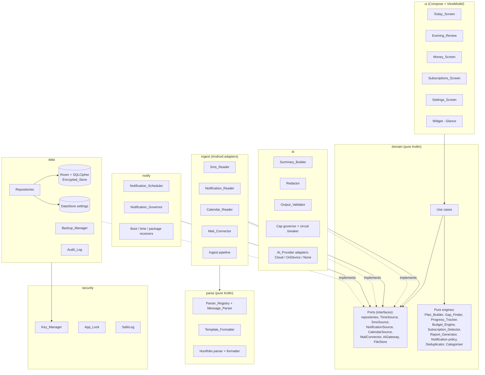
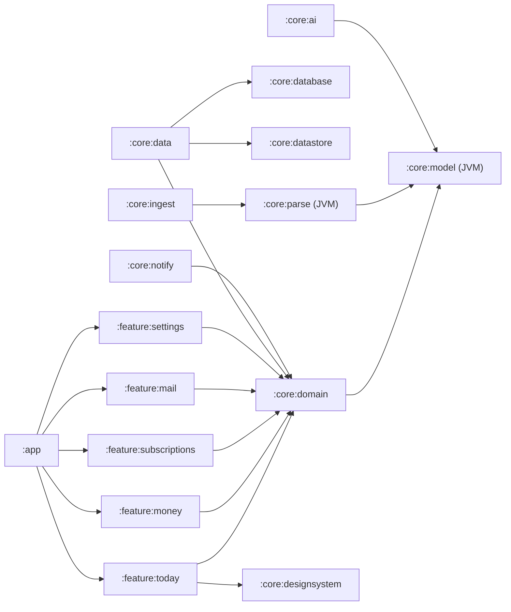
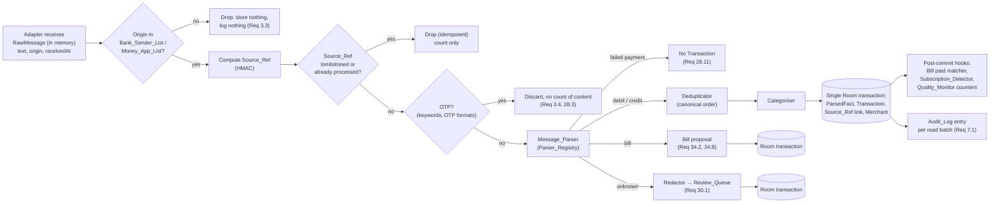
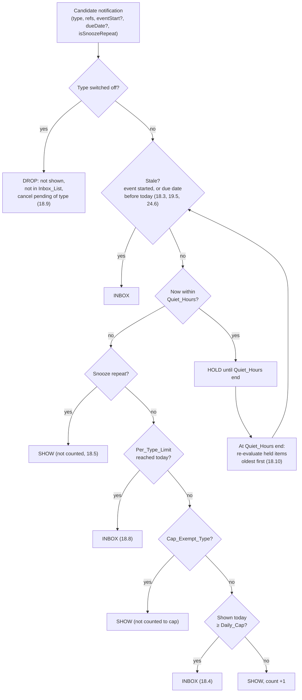
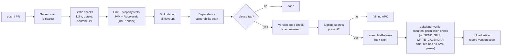
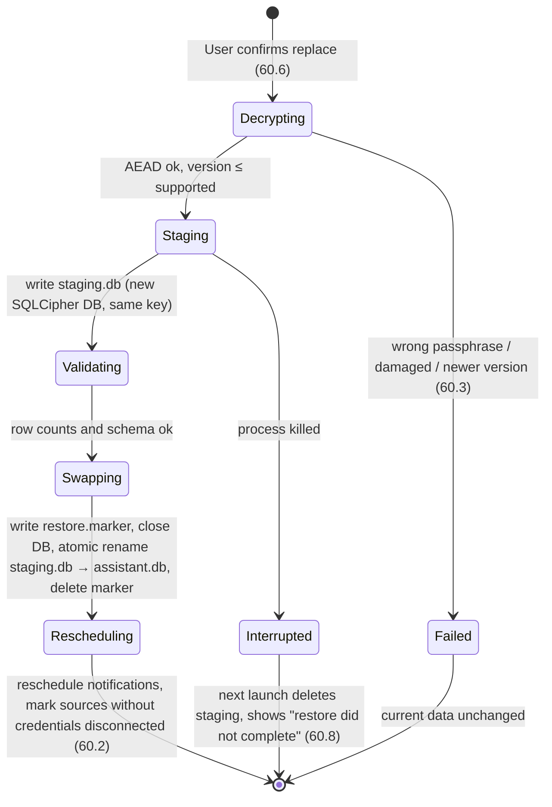
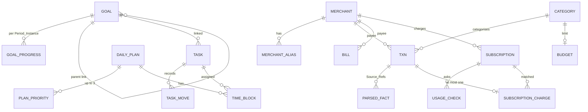

# Design Document

## Overview

This document describes how to build the Assistant_App specified in `requirements.md`: a local-first Android assistant that builds a daily plan, tracks goals, money and subscriptions from the User's own data, and optionally asks an AI_Provider for wording. It covers architecture, components and their Kotlin interfaces, the stored data, correctness properties, error handling, testing, and the build and release pipeline.

### Design goals, in priority order

1. **Privacy and safety.** User data never leaves the phone except through the three exits in Requirement 1.7. Message_Text exists only in memory. The app reads and suggests; it never acts outside itself (Requirement 2).
2. **Correctness of numbers.** Money is integer paise, dates use `java.time` with an explicit `ZoneId`, and every calculation that appears on screen is a pure function that property tests can check.
3. **Works without AI and without network.** Every feature has a Rule_Based_Result. AI only replaces wording after validation.
4. **Small and light.** One developer at about 15 hours a week, low-RAM phones, min SDK 26. Each pattern below is used only where it removes a real risk or a real cost.
5. **Ships in phases.** Each phase in the requirements' phase map can be built, used and released before the next one starts.

### Visual design language (dark, Cred-inspired)

The app is **dark-first by identity**, modelled on Cred's premium feel: an ink-black canvas, confident large type, generous radii, soft elevation, and a single restrained accent used as punctuation rather than decoration. This supersedes the earlier light/neutral direction.

- **Colour.** Fixed schemes, no Material dynamic colour, so contrast can be verified (text ≥ 4.5:1, outlines ≥ 3:1 — Req 63.4, 63.5). The dark scheme is canonical: canvas `#0B0B0F`, two raised surface steps (`#15151C` cards, `#1E1E27` sheets), off-white text `#F4F4F6` with muted `#A7A7B2`, and one accent — a desaturated indigo-violet (`#B7A8FF`) with container `#2A2440`. A high-contrast light scheme (same accent on a white canvas) is a fallback only for users who force light; `AssistantTheme` defaults to dark regardless of the system setting.
- **Type.** A confident scale with tight tracking: display 34–44sp for hero/focal text, headline 23–28sp for screen titles, calm 14–16sp body. Defined in `AssistantType`.
- **Shape.** Generous radii (`AssistantShapes`): 20dp cards, 26–32dp heroes/sheets, pill controls.
- **Components** (`ui/designsystem/CredComponents.kt`): `CredCard` (workhorse raised surface), `HeroCard` (the single focal element per screen, the only place a subtle gradient sheen is allowed — depth stays a signal, not decoration), `SectionHeader`, `ScreenTitle` (big Cred title), `EmptyState` (centered, never a bare top-left string).
- **Restraint.** No glassmorphism, no multi-stop rainbow gradients, no decorative motion. One sheen on one hero per screen; everything else is flat dark with hairline outlines.
- **Privacy interaction.** `FLAG_SECURE` is on in release (keeps data out of screenshots/recents, Req 6.5); DEBUG builds drop it, and DEBUG builds also skip the system BiometricPrompt (emulators cannot authenticate reliably), so the UI can be driven and screenshotted during development. Release always runs the real App_Lock and keeps the secure flag.


### What "enterprise practice" means here

The design borrows the practices that large Android and fintech teams use and that pay off at this size:

- Google's [Guide to app architecture](https://developer.android.com/topic/architecture) and the [Now in Android](https://github.com/android/nowinandroid) sample: UI, domain and data layers, unidirectional data flow, repositories as the single source of truth, offline-first, convention plugins and a version catalog.
- Ports and adapters (hexagonal architecture) at every boundary with the Android system or the network, so the core logic runs on the JVM in plain unit tests.
- Fintech data handling: integer minor units for money, idempotency keys, deterministic de-duplication, append-only audit records, tombstones for deleted records, and crash-safe imports.
- Security by design: a STRIDE threat model, data classification, Keystore-backed keys, and a checklist aligned with [OWASP MASVS v2.1](https://mas.owasp.org/MASVS/) (verify the current version before the Phase 7 security review).
- Architecture Decision Records (ADRs) and architecture tests that fail the build when a layer rule is broken.

Patterns that large teams use but that do not pay off here are listed with reasons in [Patterns considered and rejected](#patterns-considered-and-rejected).

### Research notes that shaped the design

- **SQLCipher.** The maintained artifact is `net.zetetic:sqlcipher-android`, which supports API 23 and up and provides a `SupportOpenHelperFactory` for Room ([sqlcipher-android README](https://github.com/sqlcipher/sqlcipher-android)). The older `android-database-sqlcipher` artifact is deprecated and is not used.
- **Exact alarms.** On Android 14, `SCHEDULE_EXACT_ALARM` is denied by default for most newly installed apps targeting Android 13 and later, and the user must grant it ([Android 14 behaviour change](https://developer.android.com/about/versions/14/changes/schedule-exact-alarms)). This matches the Exact_Alarm_Access definition and the inexact fallback in Requirement 19.3. `USE_EXACT_ALARM` is reserved by Play policy for alarm and calendar apps (verify) and is not declared.
- **Backup.** On Android 12 and later, `android:allowBackup="false"` alone does not stop device-to-device transfer. Requirement 1.8 therefore needs both `allowBackup="false"` and a `dataExtractionRules` file that excludes every domain for both cloud backup and device transfer (verify against current docs during Phase 0).
- **Architecture tests.** [Konsist](https://github.com/LemonAppDev/konsist) runs as ordinary JUnit tests and has an `assertArchitecture` API for layer rules, which lets a single Gradle module enforce package boundaries.
- **Passphrase KDF.** The OWASP Password Storage Cheat Sheet recommends Argon2id for new systems, with PBKDF2-HMAC-SHA256 at 600,000 iterations or more as the alternative ([OWASP cheat sheet](https://github.com/OWASP/CheatSheetSeries/blob/master/cheatsheets/Password_Storage_Cheat_Sheet.md)). Export_Files are attacked offline, so the design uses Argon2id with parameters above the OWASP minimum and stores them in the file header (see [Export_File format](#export_file-format)).

Content from these sources was rephrased for compliance with licensing restrictions.

### Proposed defaults

The requirements leave several values to the design. These are proposed defaults, all configurable, and all need the User's confirmation. None of them is a product decision that the requirements leave open (those stay open; see [ADR list](#architecture-decision-records)).

| Setting | Proposed default | Range or note |
|---|---|---|
| Morning brief time / evening review time | 08:00 / 21:00 | From requirements |
| Working_Hours | 09:00 to 18:00 | User-set |
| Quiet_Hours | 22:30 to 07:00 | User-set, may span midnight |
| Daily_Cap | 8 | 1 to 20 |
| Per_Type_Limit | 3 for every type, 8 for event reminder | 1 to 20 |
| Cap_Exempt_Type | none | Confirm whether event reminders should be exempt by default |
| Lock_Timeout | 60 seconds | 0 s to 30 min |
| Last day of the week | Sunday | User-set |
| Min_Focus_Length | 30 minutes | 15 to 240 |
| Event_Lead_Time | 15 minutes | From requirements |
| Duplicate_Window | 15 minutes | Configurable |
| Amount_Tolerance | 5 percent | Configurable |
| Charge_Window | 3 days | Configurable |
| Min_Occurrences | 3 | 2 or more; 2 finds more subscriptions but with more false detections |
| Mail_Sync_Interval | 60 minutes | 15 min to 24 h |
| Snippet_Length | 200 characters | 0 to 500 |
| Importance_Threshold | 7 | 0 to 10 |
| Mail digest time | 18:00 | User-set |
| AI circuit breaker | open after 3 consecutive failed AI_Requests, half-open after 30 minutes | Technical setting, not user-facing |
| Export KDF | Argon2id, 64 MiB, 3 passes, parallelism 1 | Floor: 19 MiB, 2 passes; measured on Low_RAM_Profile |

## Architecture

### Architectural principles

| Principle | How it is applied |
|---|---|
| Unidirectional data flow | Room emits `Flow`s, repositories expose them, ViewModels combine them into one immutable `UiState`, Compose renders it, and user actions go back as `UiEvent`s. |
| Single source of truth | The Encrypted_Store is the only source of truth for user data. The calendar cache, Inbox_Items and Transactions are all stored facts in it. Screens never read the SMS, calendar or mail providers directly. |
| Functional core, imperative shell | Every rule that decides something (plan building, gap finding, notification policy, parsing, dedupe, subscription detection, reports, redaction, validation) is a pure Kotlin function over value types and an explicit `now`. Adapters and repositories do the I/O around it. |
| Ports and adapters | The domain declares interfaces (ports) for each external system. Android and network code implements them (adapters). Tests use in-memory fakes. |
| Deterministic and idempotent ingest | Every message has a Source_Ref that acts as an idempotency key. Dedupe processes facts in a canonical order, not arrival order. |
| Fail closed | If a check cannot run (Audit_Log write fails, Redactor errors, key unavailable), the action that depends on it does not happen. |
| Explicit time | No code calls `System.currentTimeMillis()`, `LocalDate.now()` or `ZoneId.systemDefault()` outside the `TimeSource` adapter. |

### Layered and component view



Dependency rules, enforced by Konsist tests in `src/test/.../ArchitectureTest.kt`:

| Package | May depend on | Must not depend on |
|---|---|---|
| `domain` | Kotlin stdlib, `java.time`, `kotlinx.coroutines` (core only) | `android.*`, `androidx.*`, any other app package |
| `parse` | `domain` | `android.*`, `data`, `ingest`, `ai`, `ui` |
| `ai` | `domain`, `parse` (Number_Token reuse) | `ui`, `ingest`, `data` internals |
| `data` | `domain`, `security` | `ui`, `ingest`, `ai` |
| `ingest` | `domain`, `parse` | `ui`, `data` internals (uses domain ports only) |
| `notify` | `domain` | `ui` internals, `data` internals |
| `security` | `domain` | `ui`, `ingest`, `ai` |
| `ui` | `domain` | `data`, `ingest`, `ai`, `notify` internals (Hilt wires implementations) |

Additional Konsist rules: no class outside `security.log` imports `android.util.Log` or `Timber`; no class outside `data.time` calls `Clock.systemDefaultZone()`, `ZoneId.systemDefault()` or `Instant.now()`; no class in `domain` or `parse` uses `Double` or `Float` in a property or parameter whose name contains `amount`, `paise` or `balance`; every `@Entity` lives in `data.db.entity`.

### Package layout (single module to start)

```
app/src/main/kotlin/<appId>/
  ui/          screens, ViewModels, designsystem (theme), widget, navigation
  domain/      model (value types, entities), usecase, engine (pure rules), port (interfaces), error
  data/        db (Room, DAOs, entities, migrations), repo, settings (DataStore), backup, audit, time
  ingest/      sms, notification, calendar, mail, pipeline
  parse/       money (amount/date), registry, formatter, huntfolio
  ai/          provider (cloud, ondevice, none), summary, redact, validate, prompt, budget
  notify/      scheduler, governor, channels, receivers
  security/    keys, lock, log, network (egress allow-list)
  app/         Application class, Hilt modules, feature flags
app/src/withSms/kotlin/<appId>/ingest/sms/   Sms_Reader (absent from Sms_Free_Build)
```

`<appId>` is a placeholder until Open decision 1 (app name) is made.

### Modularisation path

The project starts as one Gradle module (`:app`) as the fixed constraints require. Package boundaries are enforced by Konsist from day one, so the later split is a move, not a redesign. Build logic still uses Now in Android conventions from Phase 0: a Gradle version catalog (`gradle/libs.versions.toml`) and an included build `build-logic/` with convention plugins (`assistant.android.application`, `assistant.android.room`, `assistant.android.hilt`, `assistant.jvm.library`).

Split triggers (any one): clean build time above 3 minutes on the developer's machine, a second developer joining, or the need to run `parse`/`domain` tests without Android Gradle Plugin overhead. The target layout then follows Now in Android:



`:core:model`, `:core:parse` and the engines in `:core:domain` are plain JVM modules, so most tests stay fast.

### Patterns considered and rejected

| Pattern | Reason for rejecting it here |
|---|---|
| Microservices / any backend for user data | Requirement 1.6 forbids server storage; the only server is the stateless Proxy_Server. |
| CQRS with separate read stores | Room `Flow` queries over one database already give reactive reads; a second store doubles migration and wipe work. |
| Full event sourcing | Fact tables plus an append-only Audit_Log give the needed history; replaying events on low-RAM phones costs startup time and storage. Dedupe borrows one idea from it (deterministic recompute from stored facts) only where confluence needs it. |
| Kafka-style message bus / in-app event bus | The ingest pipeline is a direct function chain inside one process; a bus adds ordering and delivery problems with no consumer that needs decoupling. |
| Dynamic feature modules on day one | APK distribution is the first channel and Play delivery is undecided; on-demand delivery adds install states to test for no size win at this scale. |
| Multi-module from day one | Konsist gives the same boundary checks in one module without the Gradle setup cost for one developer. |
| Redux-style global store | Per-screen ViewModels with immutable `UiState` give unidirectional flow without a global reducer that every feature must touch. |
| GraphQL / BFF for AI calls | One request type per Prompt_Type through one interface is enough; the Proxy_Server only forwards. |
| Remote config / remote feature flags | Needs a server and network; phase toggles are build-time flags plus local settings. |
| Third-party analytics or crash reporting | Forbidden by Requirement 9.2; local-only diagnostics replace them. |
| Kotlin Multiplatform | Only Android is in scope; it would complicate SQLCipher and Keystore integration. |
| A rules engine library (Drools-style) | Parser and policy rules are small, data-driven and testable as plain Kotlin; an engine adds a runtime and a DSL. |
| ML-based SMS parsing on device | The requirements choose exact rule-based parsing with an optional AI fallback; a model adds size and non-determinism. |

### Architecture Decision Records

ADRs are kept as short Markdown files in `docs/adr/NNNN-title.md` (context, decision, consequences, status). The initial set:

| ADR | Decision | Status |
|---|---|---|
| 0001 | Single Gradle module with Konsist-enforced package layers; split by Now in Android layout when a trigger fires | Accepted |
| 0002 | Room on SQLCipher (`sqlcipher-android`), random 256-bit DB passphrase wrapped by a non-auth-bound AES-256-GCM Keystore key | Accepted |
| 0003 | App_Lock is a UI gate, not a crypto gate, because background ingest must open the database without the User present | Accepted |
| 0004 | Money is `Paise` (Long); no floating point anywhere in money paths | Accepted |
| 0005 | All time through an injected `TimeSource`; timed events stored as `Instant`, all-day events as `LocalDate` | Accepted |
| 0006 | Source_Ref = source prefix + keyed HMAC of stable message identifiers; used as idempotency key and tombstone key | Accepted |
| 0007 | Message_Text never crosses a process, `Intent`, WorkManager `Data` or disk boundary; catch-up re-reads from the provider instead | Accepted |
| 0008 | Dedupe is a pure function over the set of parsed facts processed in canonical order | Accepted |
| 0009 | One exact alarm for the earliest pending Time_Specific_Reminder (alarm queue table), not one alarm per reminder | Accepted |
| 0010 | Notification_Governor is a pure policy function; all notifications pass through it | Accepted |
| 0011 | AI output refers to payload items by opaque handles; validator checks handle membership and number provenance | Accepted |
| 0012 | Retrofit + OkHttp + kotlinx.serialization for HTTP; OkHttp egress allow-list interceptor | Accepted (Ktor allowed by the fixed stack; not chosen to keep one HTTP stack) |
| 0013 | Export_File: Argon2id KDF + Tink AES-GCM-HKDF streaming AEAD, versioned header as associated data | Proposed (verify Tink subtle API on min SDK 26) |
| 0014 | Restore and import write to a staging area and commit atomically | Accepted |
| 0015 | Widget built with Jetpack Glance, reading a restricted projection | Proposed |
| 0016 | Property tests with `kotest-property` inside JUnit tests | Accepted |
| 0017 | App name | Open (Open decision 1) |
| 0018 | Cloud AI vendor and monthly cap, or on-device only | Open (Open decision 2) |
| 0019 | Mail access: IMAP with app password, or Google sign-in | Open (Open decision 3) |
| 0020 | First supported banks and UPI apps | Open (Open decision 4) |
| 0021 | APK only, or Google Play as well | Open (Open decision 5) |
| 0022 | Hindi or Tamil | Open (Open decision 6) |
| 0023 | Proxy_Server hosting and client authentication for shared builds | Open (proposal in [Proxy_Server](#proxy_server)) |
| 0024 | Review_Queue keeps encrypted redacted text until resolved (Assumption) | Proposed, awaiting User confirmation |

### Build variants and phase flags

Two flavour dimensions produce the builds the requirements need:

| Dimension | Flavours | Effect |
|---|---|---|
| `audience` | `personal`, `shared` | `personal`: Cloud AI key entered on device (Req 45.1), no Consent_Screen. `shared`: no AI key in the app, Cloud through Proxy_Server (Req 45.2), Consent_Screen and Privacy_Policy (Req 66). |
| `sms` | `withSms`, `smsFree` | `withSms`: the `withSms` source set adds `Sms_Reader` and the `READ_SMS`/`RECEIVE_SMS` manifest entries. `smsFree`: no SMS code or permission (Req 67.2 to 67.4). |

Build types: `debug` (debug-signed, never distributed) and `release` (R8, signed from Secret_Store). The release task fails if the signing config is missing (Req 10.5).

Phase flags are compile-time constants in a `FeatureFlags` object generated per build from `gradle.properties` (`phase.calendar=true`, `phase.money=true`, ...). A disabled phase removes its entry points from navigation and Settings, does not register its receivers or workers, and its permissions are not requested. Manifest components of disabled phases are declared `android:enabled="@bool/phase_x"` so a disabled phase is inert even if code is present. Optional features (Requirements 68 to 72) are runtime toggles in Settings that default off.

### Process and threading model

- One process. Coroutines with injected dispatchers (`DispatcherProvider`) so tests use `StandardTestDispatcher`.
- Room on its own executor; all multi-table writes in `withTransaction`.
- An application-wide `CoroutineScope` (`ApplicationScope`, `SupervisorJob`) runs ingest started from receivers and the notification listener.
- `BroadcastReceiver`s use `goAsync()` and hand work to `ApplicationScope`; they never pass Message_Text to WorkManager or another component (ADR 0007).
- WorkManager for deferrable jobs with unique names; AlarmManager for Time_Specific_Reminders.

| Unique work name | Kind | Purpose | Phase |
|---|---|---|---|
| `maintenance-daily` | Periodic 24 h, flex 2 h | Missed reports, Suggestion expiry (7 days), Usage_Check due marking, subscription missed-charge check, Audit_Log size check | 1 |
| `calendar-refresh` | One-time, content-URI trigger + expedited on foreground | Refresh Calendar_Cache_Window | 2 |
| `sms-catchup` | One-time on process start / boot | Re-read Bank_Sender_List SMS since last processed Received_Time (Req 26.6) | 3 |
| `sms-history-import` | One-time, user-started, foreground service type `dataSync` | SMS_History_Import | 3 |
| `ai-request-<type>-<key>` | One-time, network constraint | Deferred AI_Requests (not for interactive ones) | 5 |
| `mail-sync` | Periodic, Mail_Sync_Interval, network constraint | Mail_Sync | 6 |
| `health-check` | Periodic 6 h | Health_Check of jobs and permissions | 7 |

WorkManager stores its own data unencrypted in app storage. Work `Data` therefore carries only IDs and enum names, never Message_Text, amounts, names or Source_Refs.

### Ingest pipeline

All money messages pass through one chain of stages. Each stage is a small class behind a `PipelineStage` interface (chain of responsibility). Stages before "Parse" see Message_Text; stages after "Parse" see only Parsed_Message fields, except the Review_Queue branch, which receives redacted text.



Notes:

- The RawMessage `String` cannot be zeroed in the JVM. The design limits its lifetime to one pipeline call, never logs it, never puts it in an exception message (`ParseError` carries field names and Bank_Format IDs only), and never caches it.
- The "already processed" check uses a `processed_source_ref` table (Source_Ref, outcome, processed_at). OTP_Messages are recorded there only as a Source_Ref HMAC with outcome `otp`, so a re-read by catch-up does not reprocess them; no content is kept. If even that is judged too much, the OTP outcome can be skipped at the cost of re-parsing OTPs on catch-up, which is harmless.
- Live SMS and the SMS_History_Import produce the same Source_Ref for the same SMS (see [Source_Ref scheme](#source_ref-scheme)), so the idempotence property (Req 29.3) holds across both paths.

### Notification decision flow

Every candidate notification, from any feature, goes through the Notification_Governor. The policy is a pure function; the scheduler applies its decision.



Interpretation to confirm: Requirement 18.10 says held notifications are shown "counting each one toward the Daily_Cap". The design re-runs the full policy for each held item at the end of Quiet_Hours, so a held item goes to the Inbox_List if the cap or per-type limit is reached by earlier items in the same release. This keeps the cap invariant true at all times.

The per-type limit is checked before the exemption, so Cap_Exempt_Types are still limited by their own Per_Type_Limit (Req 18.8 applies to every type).

### AI call flow

```mermaid
sequenceDiagram
    participant F as Feature use case
    participant RB as Rule-based engine
    participant SB as Summary_Builder
    participant RD as Redactor
    participant G as AiGateway (cap + breaker)
    participant AL as Audit_Log
    participant P as AI_Provider adapter
    participant V as Output_Validator

    F->>RB: build Rule_Based_Result
    RB-->>F: result (shown at once, 43.4)
    F->>SB: build payload for Prompt_Type (schema fields only)
    SB->>RD: redact(payload)
    RD-->>SB: Redacted_Payload or RedactionError
    alt RedactionError or length > 4,000
        SB-->>F: Skip (keep Rule_Based_Result, 46.6, 46.7)
    else ok
        F->>G: request(promptType, payload, modeEpoch)
        loop up to 3 AI_Attempts (43.2)
            G->>G: mode None? offline? breaker open? cap would be exceeded?
            G->>AL: append(entry with exact payload)
            alt audit write failed
                G-->>F: Fail (no send, 7.3)
            end
            G->>P: send(payload) with 30 s timeout
            P-->>G: raw text or error
            G->>G: record usage against cap (45.3)
            G->>V: validate(raw, payload, promptType)
            V-->>G: Accepted(object) or Rejected(reason)
        end
        G-->>F: Accepted or Failed
        alt Accepted and modeEpoch unchanged (42.7)
            F->>F: replace wording; plan changes become Suggestions (48.7)
        else Failed
            F->>F: keep Rule_Based_Result + "AI wording unavailable" (43.3)
        end
    end
```

The Audit_Log entry and the cap reservation happen per AI_Attempt, because Requirement 7.2 records each send and Requirement 45.3 counts retries.

### Security architecture

#### Data classification

| Class | Examples | Where it may exist | Rules |
|---|---|---|---|
| Secret | Database key, Keystore wrapping keys, Source_Ref HMAC key, mailbox credentials and tokens, Cloud AI key, Export_Passphrase, OTP values | Keystore; wrapped blobs in `no_backup` files; Export_Passphrase only in memory during export/restore | Never logged, never in Redacted_Payloads, never in Export_Files (Req 60.5), never shown on screen |
| Sensitive personal | Message_Text, Review_Queue redacted text, Transactions, balances, Inbox_Items, Audit_Log payloads, Bills, Subscriptions | Memory (Message_Text only); Encrypted_Store | Message_Text only in memory; others only in Encrypted_Store and Export_Files; never in WorkManager data, Intents, logs or widget |
| Personal | Goals, Tasks, Daily_Plans, Calendar_Events cache, Shortlist_Rules, Merchant corrections | Encrypted_Store; Widget shows Priority titles and next event only (Req 21.4) | Same as above, except the limited widget projection |
| Non-personal configuration | Notification times, toggles, Parser_Registry, default Merchant list, Instruction_Pattern_List, prompt files | APK assets, DataStore | May be in plain DataStore; included in Export_File settings |

DataStore holds only non-personal configuration. Anything a User types that names people, senders or merchants (Shortlist_Rules, Bank_Sender_List additions, Money_App_List) is stored in Room.

#### Threat model (STRIDE)

| Threat | Example | Mitigation | Requirements |
|---|---|---|---|
| Spoofing | A malicious SMS from a look-alike sender ID claims a refund | Exact Bank_Sender_List matching with stored prefix/suffix patterns; parsing creates facts only; no action follows message content | 4.1, 26.1, 26.3 |
| Spoofing | Someone picks up the unlocked phone and opens the app | App_Lock with BiometricPrompt (biometric or Device_Credential), Lock_Timeout, FLAG_SECURE | 6.1 to 6.5 |
| Tampering | Edited Export_File restored to inject data | AEAD with header as associated data; any change fails decryption | 60.3 |
| Tampering | Database file copied off a rooted phone and modified | SQLCipher page HMAC detects tampering; key not available off device | 1.3 |
| Repudiation | User cannot tell what the app sent to AI | Append-only Audit_Log with the exact Redacted_Payload, written before send | 7.2, 7.3 |
| Information disclosure | Message_Text leaks via logs, crash reports, WorkManager DB, backups | SafeLog wrapper, R8 log stripping, no crash upload, ADR 0007, backup and device transfer excluded | 1.8, 3.2, 3.5, 9.2 |
| Information disclosure | PII sent to the AI vendor | Schema-limited Summary_Builder, Redactor as a pure tested function, 4,000-character limit, Audit_Log for review | 46 |
| Information disclosure | Widget or lock screen shows money | Widget projection type has no money fields; notification visibility `VISIBILITY_PRIVATE` with a public version that shows the type only | 21.4 |
| Information disclosure | Recent-apps thumbnail | `FLAG_SECURE` on the activity window | 6.5 |
| Denial of service | Flood of SMS or a 5 MB import exhausts memory | Streaming parse with size checks, per-sync caps (200 mails), bounded queues | 52.4, 59.8 |
| Denial of service | Runaway AI spend | Cap governor checks before each attempt; circuit breaker | 45.4 |
| Elevation of privilege | Prompt injection in an email makes the AI "create a task" or "visit a link" | Message_Text only in schema data fields; Instruction_Pattern_List redaction; output allow-list of fields; AI output never triggers actions, only Suggestions the User accepts; egress allow-list blocks unknown hosts | 4.2 to 4.4, 47, 54.7 |
| Elevation of privilege | Exported components abused by other apps | All activities, services and receivers `exported=false` except launcher, widget provider and the system-bound services (notification listener requires `BIND_NOTIFICATION_LISTENER_SERVICE`) | 2 |

#### Keys and cryptography

| Item | Choice |
|---|---|
| Database key | 32 random bytes from `SecureRandom`, used as the SQLCipher raw key. Wrapped with an AES-256-GCM key in the Android Keystore (`KeyGenParameterSpec`, `PURPOSE_ENCRYPT or DECRYPT`, `setUserAuthenticationRequired(false)` because background ingest needs it, StrongBox when available). The wrapped blob is stored in `noBackupFilesDir/db.key.enc`. |
| Source_Ref HMAC key | 32 random bytes, wrapped the same way, `noBackupFilesDir/ref.key.enc`. It is carried inside the encrypted content of the Export_File and re-wrapped on restore, so the same SMS gets the same Source_Ref on a restored phone and the idempotence of Requirement 29.3 survives a restore. It is not one of the items Requirement 60.5 excludes; this choice needs the User's confirmation. |
| Credential encryption | Mailbox credentials and the personal-build Cloud AI key are encrypted with a separate Keystore AES-256-GCM key and stored in the `secret` table, so they are protected twice and are excluded from export by table. |
| Export_File | Argon2id (proposed: 64 MiB, 3 passes, parallelism 1, 16-byte salt, 32-byte output) via Bouncy Castle's pure-Java `Argon2BytesGenerator` (no native code). Output feeds Tink `AesGcmHkdfStreaming` (AES-256, 1 MiB segments) for streaming encryption so a large file never sits whole in RAM. |
| Network | TLS only (`cleartextTrafficPermitted="false"`), system trust store, OkHttp `EgressAllowListInterceptor` that rejects any host not in the configured set (AI vendor host, Proxy_Server host, configured mail host). Proposed: certificate pinning only for the Proxy_Server, with a backup pin. |
| App_Lock | `BiometricPrompt` with `BIOMETRIC_STRONG or DEVICE_CREDENTIAL` on API 30 and later; `BIOMETRIC_WEAK or DEVICE_CREDENTIAL` on API 28 and 29; Device_Credential through `KeyguardManager` on API 26 and 27 (verify the supported-authenticator matrix of `androidx.biometric` during Phase 0). |

App_Lock does not gate the database key cryptographically (ADR 0003). The trade-off: a person with root access and the phone unlocked could reach the data, but the alternative (auth-bound key) would stop SMS parsing, reminders and widget ticks whenever the app is locked, which conflicts with Requirements 19, 21.2 and 26.

#### OWASP MASVS v2.1 checklist

| Group | Design response |
|---|---|
| MASVS-STORAGE | Encrypted_Store; no Message_Text at rest; `no_backup` key files; backup and device transfer excluded; no PII in logs; no data in widget except allowed fields |
| MASVS-CRYPTO | Keystore-wrapped keys; AES-GCM only; Argon2id KDF; no custom primitives; key deletion on wipe |
| MASVS-AUTH | Local App_Lock; Lock_Timeout; no account; mailbox credentials only after a successful Connection_Test |
| MASVS-NETWORK | TLS only; egress allow-list; optional Proxy_Server pinning |
| MASVS-PLATFORM | Non-exported components; `FLAG_SECURE`; no WebView for message content; no autolinking of message-derived text; PendingIntents `FLAG_IMMUTABLE` |
| MASVS-CODE | Min SDK 26, dependency updates via Dependabot or Renovate, dependency vulnerability scan in CI, R8 |
| MASVS-RESILIENCE | R8 obfuscation; no root detection (the threat model is a lost phone, not a hostile user); release signing from Secret_Store |
| MASVS-PRIVACY | Data minimisation (facts, not messages), Audit_Log, per-source disconnect and delete, Consent_Screen and Privacy_Policy in shared builds |

#### Logging without content

- `SafeLog` accepts only `DiagnosticEvent` objects: sealed classes whose fields are enums, counts, durations, IDs of Bank_Formats and job names. There is no `log(String)` method.
- A detekt rule (`ForbiddenImport`) bans `android.util.Log`, `println` and `Timber` outside `security.log`.
- R8 rule `-assumenosideeffects class android.util.Log { *; }` strips any stray calls in release.
- Exceptions are logged as class name plus stack frames with the message removed, because exception messages from libraries can contain input text.
- Diagnostics are kept in a ring buffer table (proposed: last 1,000 events) in the Encrypted_Store. They are viewable in Settings and included in the Export_File only if the User opts in. Nothing is uploaded.

### Observability without content

| Mechanism | What it records | Where shown |
|---|---|---|
| Audit_Log | Each read (source, time, count, success) and each AI send with payload | Settings (Req 7.4) |
| Health_Check | Expected vs actual job start times, permission and channel state | Settings, health warning (Req 62) |
| Quality_Monitor | Parse outcomes per Message_Origin, corrections, Wrong_Mail_Alerts, subscription proposal outcomes, Suggestion responses | Settings (Req 36, 50, 55, 58) |
| Diagnostics ring buffer | `DiagnosticEvent`s (errors by class, timings) | Settings, developer section |

### Proxy_Server

The Proxy_Server is a small stateless HTTPS function (proposed: a serverless function such as a Cloudflare Worker or Cloud Run service; ADR 0023 is open). It holds the Cloud AI key as a platform secret, forwards one request to the configured vendor and returns the response. It writes no payload or response content to storage or logs (Req 66.3); platform request logging is configured to omit bodies. Abuse control (proposed): each shared install is given an invite token by the developer, entered once and stored in the `secret` table; the Proxy_Server keeps only per-token request counters and rejects unknown or over-limit tokens. This needs the developer's decision because it adds a manual step for friends.

### CI/CD pipeline



- GitHub Actions (proposed). Every push runs stages S1 to S5 (Req 10.2, 64.6). Any failure fails the run and blocks a release from that commit (Req 10.3, 64.5).
- Signing keystore, passwords and the Proxy_Server invite secret come from GitHub encrypted secrets (the Secret_Store), are written to a temp file in the runner, are masked in logs, and are deleted at the end of the job (Req 10.6, 10.7).
- The last distributed version code is recorded in a protected repository file updated only by the release job, or read from the latest release tag. The release job fails if the new code is not greater (Req 65.4).
- A manifest check task (`verifyReadOnlyPermissions`) parses the merged manifest of every release variant and fails if it finds `SEND_SMS`, `CALL_PHONE`, `WRITE_CALENDAR` or, for `smsFree`, any SMS permission (Req 2.1, 67.2).
- The `CLAUDE.md` file (Req 10.8) lists the project rules from Requirements 1 to 4 and 9 and the fixed stack; a CI check confirms the file exists.


## Components and Interfaces

Components are grouped by the phase that introduces them. Signatures are Kotlin and show intent; names may change during implementation. Pure engines take every input, including `now` and `zone`, as parameters.

### Phase map of components

| Phase | Components introduced |
|---|---|
| 0 Setup | `TimeSource`, `Outcome`, Key_Manager, Encrypted_Store (Room + SQLCipher), settings store, App_Lock, Permission_Manager, Audit_Log, Data_Wiper, SafeLog, egress allow-list, theme, CI |
| 1 Core | Goal_Manager, Task_Manager, Quick_Add, Plan_Builder, Today_Screen, Review_Flow, Progress_Tracker, Report_Generator (progress), Notification_Governor, Notification_Scheduler, alarm queue, receivers, Widget |
| 2 Calendar | Calendar_Reader (CalendarSource adapter + cache), Gap_Finder, event reminders, conflict detection |
| 3 Money | Sms_Reader, Notification_Reader, ingest pipeline, Parser_Registry, Message_Parser, Template_Formatter, Deduplicator, Review_Queue, Categoriser, Transaction_Editor, Budget_Engine, Bill_Tracker, Report_Generator (spending), Quality_Monitor (money) |
| 4 Subscriptions | Due_Date_Rule, Subscription_Detector, Usage_Check flow, renewal alerts |
| 5 AI advice | AiGateway, AI_Provider adapters, Summary_Builder, Redactor, Output_Validator, Output_Serializer, prompt files, Suggestion_Manager, SMS fallback parser |
| 6 Email | Mail_Connector (IMAP or Google adapter), Mail_Triage, Mail_Digest, mail Quality_Monitor metrics |
| 7 Polish | Career_Importer, Huntfolio_Formatter, Backup_Manager, Battery_Guide, Health_Check, accessibility work, fixture expansion |
| 8 Share | `shared` flavour, Consent_Screen, Privacy_Policy, Proxy_Server client, `smsFree` flavour |
| Later | Important_Date, Habit, Learning_Topic, voice capture, App_Language |

### Cross-cutting building blocks (Phase 0)

```kotlin
// domain/error
sealed interface Outcome<out T, out E> {
    data class Ok<T>(val value: T) : Outcome<T, Nothing>
    data class Err<E>(val error: E) : Outcome<Nothing, E>
}

/** Field-level validation result used by every form (Goals, Tasks, Bills, ...). */
data class FieldErrors<F : Enum<F>>(val errors: Map<F, ValidationError>) {
    val isValid: Boolean get() = errors.isEmpty()
}
enum class ValidationError { EMPTY, TOO_LONG, OUT_OF_RANGE, NOT_A_NUMBER, INVALID_DATE, IN_PAST, IN_FUTURE, DUPLICATE, LIMIT_REACHED, NOT_ALLOWED }

// domain/port
interface TimeSource {
    fun now(): Instant
    fun zone(): ZoneId                       // read fresh on each call; follows device changes
    fun today(): LocalDate = now().atZone(zone()).toLocalDate()
    val zoneChanges: Flow<ZoneId>            // emits on TIMEZONE_CHANGED / TIME_SET
}

interface DispatcherProvider { val io: CoroutineDispatcher; val default: CoroutineDispatcher; val main: CoroutineDispatcher }
```

Kotlin exceptions stay inside adapters. Each adapter maps them to a sealed error type of its port (for example `CalendarReadError.PermissionRevoked`, `MailError.AuthRejected`). Use cases return `Outcome`. ViewModels map errors to `UiState` messages.

#### Key_Manager and Encrypted_Store

```kotlin
// security/keys
interface KeyManager {
    /** Creates the DB key on first launch (Req 1.2). Returns Err if the Keystore key is missing or invalidated (Req 1.5). */
    fun databaseKey(): Outcome<ByteArray, KeyError>
    fun sourceRefKey(): Outcome<ByteArray, KeyError>
    fun encryptSecret(plain: ByteArray): Outcome<ByteArray, KeyError>
    fun decryptSecret(blob: ByteArray): Outcome<ByteArray, KeyError>
    fun deleteAll()                           // used by Data_Wiper
}
sealed interface KeyError { data object KeystoreUnavailable : KeyError; data object KeyInvalidated : KeyError; data object BlobCorrupt : KeyError }

// data/db
@Database(entities = [/* see Data Models */], version = N, exportSchema = true)
abstract class AppDatabase : RoomDatabase()

object DatabaseFactory {
    fun open(context: Context, key: ByteArray): AppDatabase =
        Room.databaseBuilder(context, AppDatabase::class.java, "assistant.db")
            .openHelperFactory(SupportOpenHelperFactory(key))   // net.zetetic:sqlcipher-android
            .addMigrations(*ALL_MIGRATIONS)                       // no fallbackToDestructiveMigration (Req 65.6)
            .build()
}
```

If `databaseKey()` returns an error, the app shows the "data cannot be unlocked" screen with "Delete everything" and (from Phase 7) restore (Req 1.5). The database file is never opened with a new key and never deleted automatically.

#### App_Lock

```kotlin
// security/lock
interface AppLock {
    val state: StateFlow<LockState>          // Locked, Unlocking, Unlocked, NoDeviceLock
    fun onForeground(nowElapsed: Long)        // compares with backgroundedAt + Lock_Timeout (Req 6.2)
    fun onBackground(nowElapsed: Long)
    suspend fun authenticate(activity: FragmentActivity): AuthResult
}
enum class AuthResult { SUCCESS, FAILED, CANCELLED, NO_CREDENTIAL }
```

`MainActivity` sets `FLAG_SECURE` in `onCreate` (Req 6.5). The navigation host shows only the lock screen while `state != Unlocked`. ViewModels for data screens are not created until unlock, so no user data is loaded into UI state while locked. Elapsed time uses `SystemClock.elapsedRealtime()` so changing the clock cannot skip the lock.

#### Permission_Manager

```kotlin
// ui/permission (Android adapter behind a domain port)
interface PermissionManager {
    fun status(feature: Feature): PermissionStatus                 // Granted, Denied, PermanentlyDenied, NotRequested
    suspend fun request(feature: Feature): PermissionStatus         // rationale → system dialog (one group per dialog, Req 5.3)
    fun openAppSettings(); fun openNotificationAccessSettings(); fun openExactAlarmSettings()
    val revocations: Flow<Feature>                                  // checked on start, foreground, background read (Req 5.7)
}
enum class Feature { NOTIFICATIONS, CALENDAR, SMS, NOTIFICATION_ACCESS, EXACT_ALARM, MICROPHONE }
```

Each Feature maps to one rationale text (what is read, which feature uses it) and one permission group. The first launch requests nothing (Req 5.1).

#### Audit_Log

```kotlin
// data/audit
interface AuditLog {
    suspend fun recordRead(source: DataSource, at: Instant, itemCount: Int, success: Boolean)
    /** Must complete before the payload is sent; Err means do not send (Req 7.3). */
    suspend fun recordAiSend(at: Instant, mode: AiMode, type: PromptType, payload: String): Outcome<AuditId, AuditError>
    suspend fun markAiResult(id: AuditId, success: Boolean)
    fun entriesNewestFirst(): PagingSource<Int, AuditEntryEntity>
}
```

The DAO has insert and query methods only. `markAiResult` inserts a separate result row linked by `auditId`, so no row is ever updated (append-only). Only the Data_Wiper deletes rows.

#### Data_Wiper and source disconnect

```kotlin
interface DataWiper {
    /** Writes wipe.pending marker first, then deletes DB files, keys, DataStore, caches, alarms, work, widget state (Req 8.5). */
    suspend fun wipeAll()
    /** Called at launch before any UI; resumes an interrupted wipe (Req 8.7). */
    suspend fun resumeIfPending(): Boolean
}
interface SourceDisconnector {
    suspend fun disconnect(source: DataSource, deleteFacts: Boolean)   // stops work, deletes credentials (Req 8.2, 8.3)
}
```

Fact deletion uses the Source_Ref prefix of the Data_Source (for example `sms:`), so it is one indexed `DELETE ... WHERE source_ref LIKE 'sms:%'` per table inside one transaction, followed by removal of Transactions left with no Source_Ref and no manual source.

### Phase 1: Core

#### Goal_Manager and Progress_Tracker

```kotlin
// domain/engine/goals
object GoalValidator {
    fun validate(input: GoalInput): FieldErrors<GoalField>          // Req 11.1, 11.2
    fun validateProgress(raw: String): Outcome<Quantity, ValidationError>   // Req 11.8
    fun validateLink(child: Goal, parent: Goal): Outcome<Unit, LinkError>   // Req 11.3, 11.7
}

/** Period_Instance arithmetic. Week instances end on the User-set last day of the week. */
object Periods {
    fun instanceContaining(period: GoalPeriod, date: LocalDate, lastDayOfWeek: DayOfWeek): PeriodInstance
}

object ProgressMath {
    fun percent(progress: Quantity, target: Quantity): Int                  // floor, may exceed 100 (Req 17.1)
    fun daysBehind(goal: Goal, progress: Quantity, today: LocalDate, lastDayOfWeek: DayOfWeek): Int   // Req 17.2
    fun streak(history: Map<LocalDate, DaySummary>, rule: StreakRule, today: LocalDate): Int            // Req 17.3
}

interface GoalRepository {
    fun activeGoals(): Flow<List<Goal>>
    suspend fun save(input: GoalInput): Outcome<GoalId, FieldErrors<GoalField>>
    suspend fun link(child: GoalId, parent: GoalId): Outcome<Unit, LinkError>
    suspend fun logProgress(goal: GoalId, amount: Quantity, on: LocalDate): Outcome<Unit, GoalError>
    suspend fun archive(goal: GoalId)
}
```

`Quantity` stores Goal targets and progress as a scaled Long (hundredths), so 0.01 to 999,999,999.99 is exact. Days_Behind uses exact rational arithmetic on hundredths with `Math.floorDiv` (no floating point). Progress is stored per Period_Instance in `goal_progress` rows, so edits and archiving never touch it (Req 11.6).

#### Task_Manager and Quick_Add

```kotlin
object TaskValidator {
    fun validate(input: TaskInput): FieldErrors<TaskField>                 // Req 12.1, 12.2, 12.6
    fun normaliseQuickAdd(raw: String): Outcome<String, ValidationError>   // line breaks → spaces, trim, 1..200 (Req 13.2, 13.4)
}

interface TaskRepository {
    fun openTasksFor(date: LocalDate): Flow<List<Task>>
    suspend fun save(input: TaskInput): Outcome<TaskId, FieldErrors<TaskField>>
    suspend fun quickAdd(raw: String, today: LocalDate): Outcome<TaskId, ValidationError>
    suspend fun markDone(id: TaskId, at: Instant)      // also Goal "tasks" progress (Req 11.5) in the same transaction
    suspend fun move(id: TaskId, to: LocalDate, today: LocalDate): Outcome<Unit, MoveError>   // Req 12.4, 12.7
    suspend fun drop(id: TaskId)
    suspend fun delete(id: TaskId)                      // removes Time_Blocks; Goal progress kept (Req 12.5)
}
```

`move` removes the Task from Priorities and Time_Blocks of the old Planned_Date and inserts a `task_move` row, all in one Room transaction.

#### Plan_Builder

```kotlin
// domain/engine/plan
data class PlanInputs(
    val date: LocalDate, val createdAt: Instant, val zone: ZoneId,
    val openTasks: List<Task>, val behindGoalIds: Set<GoalId>, val behindGoals: List<GoalStatus>,
    val bills: List<BillOccurrence>, val timedEvents: List<TimedEvent>,
    val workingHours: LocalTimeRange, val existingBlocks: List<TimeBlock>,
)

object PlanBuilder {
    /** Pure and deterministic (Req 14.5). */
    fun build(inputs: PlanInputs): DailyPlan
    fun rank(tasks: List<Task>, today: LocalDate, behindGoalIds: Set<GoalId>): List<Task>   // Req 14.2 ordering
    fun busyIntervals(date: LocalDate, zone: ZoneId, events: List<TimedEvent>, blocks: List<TimeBlock>): List<InstantRange>  // merged (Req 23.2)
}
```

Algorithm for Time_Blocks (Req 14.3, 14.4, 14.10, 23.2, 23.3):

1. Convert Working_Hours on `date` to an `InstantRange` in `zone`; clip its start to `createdAt`.
2. Busy intervals = union of the parts on `date` of timed Calendar_Events (zero-length events dropped) and existing Time_Blocks, merged and sorted.
3. Free intervals = Working_Hours minus busy, as half-open ranges `[start, end)` so touching ranges do not overlap.
4. For each Priority with an estimated duration, in rank order, place it at the start of the first free interval long enough (first fit), then subtract the placed block from the free intervals. A Priority that fits nowhere keeps no Time_Block.

Daylight-saving gaps do not occur in India, but the arithmetic is on `Instant`s converted with the given `zone`, so it stays correct in any zone.

User overrides (Req 14.7) are stored as `plan_override` rows. A rebuild for the same date applies stored overrides last, so they are never overwritten.

#### Review_Flow (Evening_Review)

```kotlin
data class ReviewDraft(val reviewDate: LocalDate, val choices: Map<TaskId, ReviewChoice?>)
enum class ReviewChoice { DONE, MOVE_TO_TOMORROW, DROP }
data class ReviewSummary(val done: Int, val moved: Int, val dropped: Int, val leftOpen: Int)

object ReviewEngine {
    fun summarise(listed: List<Task>, draft: ReviewDraft): ReviewSummary     // counts sum to listed.size (Req 16.4)
}
interface ReviewRepository {
    /** Applies all choices in one transaction (Req 16.3, 16.6); nothing is written before finish (Req 16.7). */
    suspend fun finish(draft: ReviewDraft, at: Instant): ReviewSummary
}
```

The draft lives only in the ViewModel's `SavedStateHandle`. Leaving without finishing discards it.

#### Report_Generator

```kotlin
object ReportCalculator {
    fun weeklyProgress(week: PeriodInstance, data: ProgressReportData): WeeklyProgressReport     // Req 17.5
    fun monthlySpending(month: YearMonth, txns: List<Transaction>, prev: List<Transaction>): SpendingReport  // Req 35.1
    fun weeklySpending(week: PeriodInstance, txns: List<Transaction>): SpendingReport           // Req 35.2
}
interface ReportRepository {
    /** Records that a report for a period exists; content is recalculated from data on display (Req 35.4). */
    suspend fun ensureReportsUpTo(now: Instant, zone: ZoneId)       // catch-up for missed periods (Req 17.6, 35.5)
}
```

Reports are pure functions of stored data and the period. A `report` row records only kind, period and creation time. This makes "late report equals on-time report" (Req 17.6) and "recalculate after edit" (Req 35.4) hold by construction. Goal archive dates and Task_Move dates are stored, so a report for a past week sees the same inputs later.

#### Notification_Governor (policy) and Notification_Scheduler

```kotlin
// notify/governor
data class Candidate(
    val type: NotificationType, val refKey: String, val createdAt: Instant,
    val eventStart: Instant? = null, val dueDate: LocalDate? = null, val isSnoozeRepeat: Boolean = false,
)
data class GovernorState(val shownToday: Int, val shownTodayByType: Map<NotificationType, Int>, val day: LocalDate)
data class GovernorSettings(
    val enabled: Set<NotificationType>, val quietHours: LocalTimeRange?, val dailyCap: Int,
    val perTypeLimit: Map<NotificationType, Int>, val capExempt: Set<NotificationType>,
)
sealed interface Decision {
    data object Show : Decision
    data object ShowUncounted : Decision
    data class Hold(val until: Instant) : Decision
    data class ToInbox(val reason: InboxReason) : Decision
    data object Drop : Decision
}

object NotificationPolicy {
    fun decide(c: Candidate, s: GovernorState, cfg: GovernorSettings, now: Instant, zone: ZoneId): Decision
    fun quietHoursEnd(now: Instant, zone: ZoneId, quiet: LocalTimeRange): Instant?   // handles ranges over midnight
}

// notify/scheduler
interface NotificationScheduler {
    suspend fun schedule(item: ScheduledItem)            // writes alarm_queue row, re-arms the single alarm
    suspend fun cancel(type: NotificationType, refKey: String)
    suspend fun cancelAll(type: NotificationType)
    suspend fun rescheduleAll(reason: RescheduleReason) // BOOT, TIME_CHANGED, ZONE_CHANGED, PACKAGE_REPLACED, EXACT_ALARM_CHANGED
    suspend fun onAlarmFired(now: Instant)              // processes all due rows, then re-arms
}
```

Scheduling strategy (ADR 0009):

- The `alarm_queue` table holds every pending item: type, refKey, the rule for its time (`AtLocalTime(date, time)` for morning brief and evening review, `AtInstant(instant)` for event reminders and snoozes), and status.
- One AlarmManager alarm is set for the earliest due row. With Exact_Alarm_Access it is `setExactAndAllowWhileIdle`; without it, `setAndAllowWhileIdle` and Settings shows the late-reminder notice (Req 19.3). The Device_Test_Plan checks whether the Doze rate limit on allow-while-idle alarms causes misses when two reminders are close together; if it does, the fallback is `setAlarmClock` for the next item (verify).
- On fire, all rows due at or before `now + 30 s` are processed through the governor, then the next alarm is set. This keeps one alarm in the system and makes reboot rescheduling one call.
- Receivers: `BOOT_COMPLETED`, `TIME_SET`, `TIMEZONE_CHANGED`, `MY_PACKAGE_REPLACED`, and `SCHEDULE_EXACT_ALARM_PERMISSION_STATE_CHANGED` (API 31 and later) call `rescheduleAll` (Req 19.1, 19.4, 65.5). `AtLocalTime` rows are re-resolved in the new zone; `AtInstant` rows keep their instant.
- Rows whose time passed while the device was off are classified with the same staleness rule as the governor (Req 19.5).
- Notification channels: one per Notification_Type, created at startup. Health_Check reads each channel's importance to detect a channel the User turned off (Req 62.2).
- Each notification carries a "Why am I seeing this?" action (Req 18.6) that opens `WhyActivity` with only the notification row ID; the explanation is built from the stored rule ID and settings at display time.
- Lock-screen visibility is `VISIBILITY_PRIVATE` with a public version that names the Notification_Type only. What the morning brief shows on the lock screen is still open in the requirements; this is a proposed default.

#### Widget

```kotlin
/** The only data type the widget can read; it has no money, Bill, Goal-progress or email fields (Req 21.4). */
data class WidgetModel(val priorities: List<WidgetPriority>, val nextEvent: WidgetEvent?, val state: WidgetState)
data class WidgetPriority(val taskId: TaskId, val title: String, val done: Boolean)
data class WidgetEvent(val start: LocalTime, val title: String)
enum class WidgetState { READY, NO_PRIORITIES, EMPTY_AFTER_WIPE }

interface WidgetUpdater { suspend fun refresh() }      // called after Task, plan, event or date change (Req 21.3)
```

The Glance widget calls `TaskRepository.markDone` from an `ActionCallback` without App_Lock (Req 21.2). Quick_Add from the widget opens the app's Quick_Add screen; whether that screen needs App_Lock authentication is open in the requirements, and the proposed default is to require it because the screen then shows today's Tasks. Updates come from a repository `Flow` observed in a lightweight updater plus `updatePeriodMillis` as a fallback for date changes.

### Phase 2: Calendar

```kotlin
// domain/port
interface CalendarSource {                                  // adapter over CalendarContract
    suspend fun calendars(): Outcome<List<CalendarInfo>, CalendarReadError>
    /** Reads CalendarContract.Instances (expanded occurrences) for selected calendars overlapping the window. */
    suspend fun instances(window: InstantRange, calendarIds: Set<Long>): Outcome<List<CalendarEventFact>, CalendarReadError>
    val changes: Flow<Unit>                                 // ContentObserver on CalendarContract.CONTENT_URI
}

object CalendarCachePolicy {
    fun window(today: LocalDate, zone: ZoneId): InstantRange             // 00:00 today to 24:00 on today+7
    fun keep(e: CalendarEventFact, window: InstantRange, zone: ZoneId): Boolean   // overlap, not cancelled, not declined
}

interface CalendarRepository {
    suspend fun refresh(): Outcome<RefreshStats, CalendarReadError>     // replaces cache in one transaction (Req 22.4, 22.8)
    fun eventsOn(date: LocalDate): Flow<DayEvents>                       // timed + all-day
    val lastSuccessfulRefresh: Flow<Instant?>
}

object GapFinder {
    fun freeGaps(date: LocalDate, now: Instant, zone: ZoneId, workingHours: LocalTimeRange,
                 events: List<TimedEvent>, blocks: List<TimeBlock>, minFocus: Duration): List<InstantRange>   // Req 25.1
    fun proposal(gap: InstantRange, rankedTasks: List<Task>, alreadyProposed: Set<TaskId>): FocusBlockProposal?  // greedy first-fit (Req 25.2, 25.3)
    fun place(p: FocusBlockProposal, now: Instant): List<TimeBlock>      // back to back (Req 25.4)
}

object ConflictDetector {
    fun conflicts(blocks: List<TimeBlock>, events: List<TimedEvent>): Set<TimeBlockId>
    fun suggestMove(block: TimeBlock, date: LocalDate, gaps: List<InstantRange>): InstantRange?   // earliest later gap (Req 23.6)
}
```

The adapter reads `CalendarContract.Instances` (which expands recurring events and applies single-occurrence exceptions) and filters `STATUS_CANCELED` and `SELF_ATTENDEE_STATUS == ATTENDEE_STATUS_DECLINED` (Req 22.6). Timed events are stored as `Instant`s and all-day events as `LocalDate`s, since the provider stores all-day events in UTC (Req 22.5). A failed refresh leaves the cache as it was (Req 22.8).

Event reminders are scheduled as `AtInstant(start − Event_Lead_Time)` rows keyed by the event's Source_Ref. After each refresh, the scheduler diffs the reminder rows against the cache: added, moved and removed events are scheduled, rescheduled and cancelled (Req 24.2, 24.3, 24.5).

### Phase 3: Money

#### Message sources

```kotlin
// domain/port
data class RawMessage(                                     // in memory only (ADR 0007)
    val text: String, val origin: MessageOrigin, val receivedAt: Instant,
    val stableIds: StableIds,                              // inputs to Source_Ref, never stored
)
sealed interface MessageOrigin { data class Sms(val senderId: String) : MessageOrigin; data class App(val packageName: String) : MessageOrigin }

interface SmsSource {                                      // withSms source set only
    val incoming: Flow<RawMessage>                         // SMS_RECEIVED; multipart joined (Req 26.7)
    suspend fun inboxSince(since: Instant, filter: SenderFilter): Flow<RawMessage>   // catch-up and history import
}
interface MoneyNotificationSource {
    val incoming: Flow<RawMessage>                         // NotificationListenerService.onNotificationPosted
    suspend fun activeNow(filter: AppFilter): List<RawMessage>   // on listener reconnect
}

object SenderMatcher {
    fun matches(senderId: String, list: List<SenderEntry>): Boolean   // case-insensitive; prefix/suffix patterns (Req 26.1)
}
```

The `SenderEntry` patterns cover Indian DLT-style headers such as `AX-HDFCBK` or `VM-HDFCBK-S` by storing the core header (`HDFCBK`) with an optional operator prefix pattern and suffix pattern. The first supported banks are open (Open decision 4); the list is data in `assets/bank_senders.json` plus User additions in Room.

The Notification_Reader reads only `extras` title and text of notifications from apps in the Money_App_List, never calls `cancelNotification`, and never fires a notification's `PendingIntent` (Req 2.3).

#### Ingest pipeline

```kotlin
// ingest/pipeline
sealed interface StageResult {
    data class Continue(val ctx: IngestContext) : StageResult
    data class Stop(val outcome: IngestOutcome) : StageResult
}
fun interface PipelineStage { suspend fun process(ctx: IngestContext): StageResult }

class IngestPipeline(private val stages: List<PipelineStage>) {
    suspend fun ingest(msg: RawMessage): IngestOutcome
}
enum class IngestOutcome { DROPPED_UNLISTED, DUPLICATE_REF, OTP, FAILED_PAYMENT, REVIEW_QUEUED, BILL_PROPOSED, TXN_CREATED, TXN_LINKED, TOMBSTONED, ERROR }
```

Stage order: `SenderFilterStage`, `SourceRefStage`, `ProcessedRefStage`, `OtpStage`, `ParseStage`, then a branch to `ReviewQueueStage`, `BillProposalStage` or `DedupeStage → CategoriseStage → PersistStage`. `PersistStage` runs post-commit hooks (Bill paid matcher, Subscription_Detector, Quality_Monitor). An exception in any stage is caught by the pipeline, mapped to `IngestOutcome.ERROR` with a `DiagnosticEvent` that names the stage, and processing continues with the next message (Req 28.5).

#### Parser_Registry, Message_Parser and Template_Formatter (strategy + registry)

```kotlin
// parse/registry
data class BankFormat(
    val id: String,                           // e.g. "hdfc.debit.upi.v2"
    val origins: List<OriginPattern>,         // which senders/apps it applies to
    val kind: FormatKind,                     // DEBIT, CREDIT, BILL, OTP, FAILED, REVERSAL
    val template: Template,                   // ordered literal and field tokens
    val dateOrder: DateOrder, val dateSeparators: Set<Char>,
)
sealed interface TemplateToken {
    data class Literal(val text: String) : TemplateToken
    data class Field(val name: FieldName, val pattern: FieldPattern) : TemplateToken
}

interface ParserRegistry {
    fun formatsFor(origin: MessageOrigin): List<BankFormat>    // OTP formats first (Req 28.3)
    val otpKeywords: List<String>
}

object MessageParser {
    fun parse(text: String, origin: MessageOrigin, receivedAt: Instant, zone: ZoneId, registry: ParserRegistry): ParseResult
}
sealed interface ParseResult {
    data class Parsed(val message: ParsedMessage, val formatId: String) : ParseResult
    data object Otp : ParseResult
    data class FailedPayment(val formatId: String) : ParseResult
    data class Unknown(val reason: UnknownReason) : ParseResult   // NO_MATCH, INVALID_AMOUNT, INVALID_DATE, FUTURE_DATE, FIELD_ERROR
}

object AmountParser { fun parse(token: String): Outcome<Paise, AmountError> }          // Req 28.2
object DateTimeParser { fun parse(date: String?, time: String?, order: DateOrder, receivedAt: Instant, zone: ZoneId): Outcome<LocalDateTime, DateError> }  // Req 28.9

object TemplateFormatter {
    fun canHold(format: BankFormat, m: ParsedMessage): Boolean
    fun render(format: BankFormat, m: ParsedMessage, style: RenderStyle): String     // Req 28.6
}
```

Bank_Formats are JSON in `assets/parser_registry/*.json`, compiled at startup into matchers. A template compiles to an anchored regular expression with named groups, built from tokens, so one definition serves both parsing and rendering. That shared definition is what makes the round-trip property (Req 28.7) a real check of the parser and not of two separate hand-written regexes. Matching uses `java.util.regex` with possessive quantifiers in field patterns to avoid catastrophic backtracking on long inputs, and inputs longer than 2,000 characters are sent to the Review_Queue without matching.

`RenderStyle` lets property tests pick among the Currency_Marker forms, grouping styles and decimal counts the format allows.

#### Deduplicator

```kotlin
// domain/engine/dedupe
data class ParsedFact(                                  // stored; extracted fields only
    val sourceRef: SourceRef, val origin: MessageOrigin, val sourceKind: SourceKind,   // SMS or APP
    val type: TxnType, val amount: Paise, val at: Instant, val receivedAt: Instant,
    val reference: String?, val account4: String?, val merchantOrVpa: String?, val balance: Paise?, val isReversal: Boolean,
)

object Deduplicator {
    /** Partition facts into payments. Pure; facts are sorted canonically (at, receivedAt, sourceRef) first, so arrival order cannot change the result (Req 29.4). */
    fun cluster(facts: Collection<ParsedFact>, window: Duration, forcedMerges: Set<Set<SourceRef>>): List<Cluster>
    /** Field resolution: User edits > SMS over app > earlier receivedAt > lower sourceRef (Req 29.6). */
    fun resolve(cluster: Cluster, userEdits: UserEdits?): ResolvedTransaction
}
```

Matching rule for a fact joining a cluster (Req 29.1, 29.2, 29.5, 29.7): same type, same amount, |time difference| ≤ Duplicate_Window, references equal where both present (ignoring spaces and case), account last 4 equal where both present, and no fact from the same Message_Origin already in the cluster, unless type, amount and reference are all equal (criterion 5). When several clusters qualify, the nearest by time wins, then the earlier one.

Persistence: on each new fact, the repository loads the candidate neighbourhood (same type and amount, time within two windows of the new fact, transitively), recomputes clusters for it, and reconciles with stored Transactions in one transaction. A Transaction keeps its ID when its cluster keeps any of its Source_Refs; if two stored Transactions fall into one cluster, the lower ID is kept and User edits of both are preserved (the User's edit wins over parsed values; when both have an edit of the same field, the more recent edit wins). Manual Transactions are not in the fact set (Req 32.3). User merges are stored as forced merges so a recompute never splits them (Req 32.4).

#### Review_Queue, Categoriser, Transaction_Editor, Budget_Engine, Bill_Tracker

```kotlin
interface ReviewQueueRepository {
    suspend fun add(ref: SourceRef, redactedText: String, origin: MessageOrigin, receivedAt: Instant)   // one per ref (Req 30.1)
    suspend fun resolve(id: ReviewItemId, input: ManualTxnInput): Outcome<TransactionId, FieldErrors<TxnField>>   // via Deduplicator (Req 30.3)
    suspend fun dismiss(id: ReviewItemId)                // deletes text, tombstones ref (Req 30.4)
    fun openItemsNewestFirst(): Flow<List<ReviewItem>>   // Req 30.8
}

object Categoriser {
    fun matchMerchant(nameOrVpa: String, merchants: List<Merchant>): Merchant?       // exact, case-insensitive, trimmed (Req 31.2)
    fun categoryFor(merchant: Merchant?, latestCorrection: CategoryId?): CategoryId   // correction > default > Uncategorised (Req 31.1)
}

object TransactionValidator { fun validate(input: TxnInput, today: LocalDate, manual: Boolean): FieldErrors<TxnField> }   // Req 32.6

object BudgetEngine {
    fun spent(category: CategoryId, month: YearMonth, txns: List<Transaction>, zone: ZoneId): Paise   // debits only, Reversals excluded
    fun status(budget: Budget, spent: Paise): BudgetStatus                                         // remaining, percent, over (Req 33.3, 33.5, 33.7)
}

object BillRules {
    fun nextDue(first: LocalDate, current: LocalDate, recurrence: Recurrence): LocalDate      // anchored month-end clamp (Req 34.4)
    fun paidCandidate(txn: Transaction, unpaid: List<BillOccurrence>): BillOccurrence?       // exact amount, ±5 days, nearest due (Req 34.3)
}
```

Deleting a Transaction writes its Source_Refs to `tombstone` (Req 32.7). Dismissing a Review_Queue item does the same (Req 30.4). The `ProcessedRefStage` checks both tables.

#### Quality_Monitor (money)

```kotlin
interface QualityMonitor {
    suspend fun recordParse(origin: MessageOrigin, day: LocalDate, outcome: ParseOutcomeKind)   // counts only (Req 36.4)
    suspend fun recordCorrection(sourceRef: SourceRef)    // once per message (Req 36.1)
    fun accuracy(origin: MessageOrigin, today: LocalDate): Flow<AccuracyValue>   // 30-day rolling (Req 36.2)
}
object QualityMath { fun accuracy(parsed: Int, corrected: Int, review: Int): BigDecimal? }   // null → "no data"
```

Daily counters are stored per (origin, day). Corrections are attributed to the day of the original message's Received_Time.

### Phase 4: Subscriptions

```kotlin
// domain/engine/subscriptions
object DueDateRule {
    fun next(after: LocalDate, interval: SubscriptionInterval, anchorDay: Int): LocalDate   // Glossary rule
}

object SubscriptionDetector {
    fun detect(debits: List<Transaction>, existing: List<Subscription>, cfg: DetectionConfig): List<SubscriptionProposal>  // Req 37.1, 37.3, 37.5
    fun yearlyCost(amount: Paise, interval: SubscriptionInterval): Paise                   // exact, Math.multiplyExact (Req 38.2)
    fun matchCharge(txn: Transaction, active: List<Subscription>, cfg: DetectionConfig): ChargeMatch   // advance, price change or none (Req 38.4, 38.5)
    fun missedCharges(active: List<Subscription>, today: LocalDate, cfg: DetectionConfig): List<SubscriptionId>   // Req 38.7
}

object UsageCheckRules {
    fun isDue(sub: Subscription, lastAnswer: LocalDate?, today: LocalDate): Boolean          // 30 days (Req 39.1)
    fun afterAnswer(state: UsageState, answer: UsageAnswer): UsageOutcome                     // consecutive "No" count (Req 40.1, 40.2, 40.4)
}
```

Detection algorithm: group debit Transactions by Merchant; for each Subscription_Interval, sort by date and find the longest chain where each next charge lies within Charge_Window of `DueDateRule.next(previous, interval, anchorDay)` and every amount is within Amount_Tolerance of the latest charge. A chain of Min_Occurrences or more becomes a proposal unless any Subscription exists for that Merchant and interval. The detector is pure and depends only on its inputs, so running it twice gives the same proposals (Req 37.5); the repository inserts proposals with a unique index on (merchant_id, interval).

Renewal alerts are `AtLocalTime(nextDue − Renewal_Lead_Time, morningBriefTime)` rows keyed by `(subscriptionId, nextDue)`, so a unique key gives at most one alert per due date (Req 41.5).

### Phase 5: AI advice

```kotlin
// ai
enum class AiMode { CLOUD, ON_DEVICE, NONE }
enum class PromptType { DAILY_PLAN, EVENING_REVIEW, WEEKLY_REVIEW, MONTHLY_MONEY_REVIEW, MAIL_CLASSIFIER, SMS_FALLBACK_PARSER }

/** Port for one AI backend. Vendors implement it; features never see vendor types (Req 42.4). */
interface AiProvider {
    val mode: AiMode
    suspend fun complete(request: ProviderRequest): Outcome<String, ProviderError>   // raw text
    suspend fun availability(): Availability
}
data class ProviderRequest(val promptType: PromptType, val promptVersion: String, val model: String, val payloadJson: String)

/** Facade used by features: cap, breaker, audit, retries, validation, mode epoch. */
interface AiGateway {
    suspend fun <T : AiOutput> request(type: PromptType, payload: RedactedPayload, schema: OutputSchema<T>): AiResult<T>
    val modeEpoch: StateFlow<Long>                 // increments on every AI_Mode change (Req 42.7)
}
sealed interface AiResult<out T> {
    data class Accepted<T>(val value: T, val epoch: Long) : AiResult<T>
    data class Unavailable(val reason: UnavailableReason) : AiResult<Nothing>   // MODE_NONE, OFFLINE, CAP_REACHED, BREAKER_OPEN, REDACTION_FAILED, TOO_LONG, ALL_ATTEMPTS_FAILED, AUDIT_FAILED
}

@JvmInline value class RedactedPayload private constructor(val json: String) {
    companion object { internal fun of(json: String) = RedactedPayload(json) }   // only Redactor can create one
}

object Redactor {
    /** Pure. Replaces PII, links and instruction patterns with typed placeholders; keeps amounts, dates and times (Req 46.2). */
    fun redact(input: String, patterns: RedactionPatterns): Outcome<String, RedactionError>
}

interface SummaryBuilder {
    fun build(type: PromptType, source: SummarySource): Outcome<RedactedPayload, SummaryError>   // fixed schema per type (Req 46.1)
}

interface OutputValidator {
    fun <T : AiOutput> validate(raw: String, payload: RedactedPayload, type: PromptType, schema: OutputSchema<T>): Outcome<T, Rejection>
}
object NumberTokens { fun extract(text: String): List<NumberValue> }      // digits, groupings, ₹/Rs/%, times, dates, English words
interface DerivationRules { fun allowed(type: PromptType, payloadNumbers: List<NumberValue>): NumberSet }

object OutputSerializer { fun <T : AiOutput> toJson(value: T, schema: OutputSchema<T>): String }   // Req 47.6

interface CapGovernor {
    suspend fun tryReserve(estimate: Usage): Boolean        // false → stop and switch to None (Req 45.4)
    suspend fun record(actual: Usage)                         // every attempt, including failures (Req 45.3)
    suspend fun monthRollover(now: Instant, zone: ZoneId)     // Req 45.7
}
```

Key design points:

- **Opaque handles (ADR 0011).** The Summary_Builder gives each Task, Goal, Bill, Subscription, category and Free_Gap a short handle (`t1`, `g2`, `gap3`). Output must refer to items by handle. The validator checks that every handle exists in the payload (Req 47.10, 48.6) and that names in free text match payload names for those handles. This turns "no invented items" into a set-membership check.
- **Number provenance (Req 47.3).** `NumberTokens.extract` normalises every number in the output (Indian and international grouping, decimals, ₹/Rs/%, `hh:mm` and 12-hour times, ISO and `d MMM` dates, English words zero to ninety-nine plus hundred, thousand, lakh and crore). Each must be in the payload's number set or in the set allowed by the Prompt_Type's Derivation_Rules (for example: difference and percentage change of two payload amounts rounded to whole rupees and whole percent; counts of payload lists; times on 5-minute steps inside a payload Free_Gap; durations of payload Tasks).
- **Strict schema.** Each Prompt_Type has a `kotlinx.serialization` class decoded with `Json { ignoreUnknownKeys = false; isLenient = false }`. The raw text, after trimming whitespace, must start with `{`, end with `}` and decode as exactly one object (Req 47.2). Maximum text lengths are checked after decoding.
- **Restricted advice (Req 47.4)** and **contact patterns (Req 47.9)** reuse the Redactor's pattern set and the Restricted_Advice_List asset.
- **Prompt files (Req 48.5).** `assets/prompts/<type>/v<N>.md` with a header naming the schema version. Tests feed fixed payloads to a `FakeAiProvider` that returns recorded outputs and check them with the validator, offline.
- **Circuit breaker.** After 3 consecutive failed AI_Requests the gateway returns `BREAKER_OPEN` for 30 minutes, then lets one request through. This saves cap and battery on a dead network or vendor outage. It is a proposed technical default.
- **Mode epoch (Req 42.7).** A result whose epoch differs from the current epoch is discarded.
- **On-device (Req 44).** The OnDevice adapter targets the platform's on-device model runtime (for example Gemini Nano through Android AICore / ML Kit GenAI; availability and API are to be verified). Proposed device requirements: Android 14 or later, 8 GB RAM or more, model present. The adapter makes no network calls; a unit test with a recording `OkHttpClient` confirms zero requests.
- **SMS fallback parser (Req 49).** Disabled by default. One request per Review_Queue item, tracked by a `fallback_attempted` flag.

```kotlin
interface SuggestionManager {
    fun visible(): Flow<List<Suggestion>>
    suspend fun accept(id: SuggestionId): Outcome<Unit, SuggestionError>   // applies exactly the stored change (Req 50.5)
    suspend fun dismiss(id: SuggestionId)
    suspend fun expire(now: Instant)                                        // ignored after 7 days (Req 50.4)
}
sealed interface ProposedChange {          // the only changes a Suggestion can make (Req 2.4)
    data class ReorderPriorities(val date: LocalDate, val order: List<TaskId>) : ProposedChange
    data class PlaceBlocks(val date: LocalDate, val blocks: List<TimeBlockDraft>) : ProposedChange
    data class SetSubscriptionStatus(val id: SubscriptionId, val status: SubscriptionStatus) : ProposedChange
    data class AcceptPriceChange(val id: SubscriptionId, val amount: Paise, val interval: SubscriptionInterval) : ProposedChange
    data object None : ProposedChange      // advice-only Suggestions
}
```

### Phase 6: Email

```kotlin
// domain/port
interface MailConnector {                       // one adapter per access method (Open decision 3)
    suspend fun connectionTest(creds: MailCredentials, timeout: Duration = 30.seconds): Outcome<List<MailFolder>, MailError>
    suspend fun fetchHeaders(since: MailCursor, folders: List<MailFolder>, max: Int = 200, snippetLength: Int): Outcome<MailBatch, MailError>
}
sealed interface MailError { data object AuthRejected : MailError; data object Unreachable : MailError; data object Timeout : MailError; data object Dropped : MailError }
data class MailBatch(val headers: List<MailHeader>, val nextCursor: MailCursor, val more: Boolean)

object MailTriage {
    fun isOtp(h: MailHeader, otpPatterns: List<Regex>): Boolean                          // Req 52.3
    fun shortlisted(h: MailHeader, rules: ShortlistRules): Boolean                       // Req 53.1
    fun ruleScore(h: MailHeader, rules: ShortlistRules): RuleScore                        // deterministic (Req 54.2)
    fun applyPenalty(score: Int, penalty: Int): Int = (score - penalty).coerceAtLeast(0) // Req 55.5
}
object SnippetExtractor {
    fun fromParts(parts: List<MimePart>, max: Int): String     // plain text, else visible HTML text; charset fallback (Req 52.5, 52.6)
}
object DigestBuilder { fun build(items: List<InboxItem>, at: Instant): Digest }            // group order, newest first (Req 56.3)
```

Adapter notes for the open access method:

- **IMAP adapter (proposed library: Jakarta/Angus Mail; check its size on low-RAM phones).** Opens folders with `EXAMINE` (read-only), fetches `ENVELOPE`, `FLAGS`, `X-GM-LABELS` where supported and `BODY.PEEK[TEXT]<0.N>` partial bodies, so `\Seen` is never set (Req 51.3). The cursor is (folder, UIDVALIDITY, last UID).
- **Google sign-in adapter.** Gmail API with the read-only scope; `messages.list` and `messages.get` with `format=metadata` plus a snippet. The read-only scope is a restricted scope with its own verification rules (verify).
- Both return the same `MailHeader` type (Req 51.1). A contract test runs the same assertions against fake servers for both adapters.

A Mail_Sync processes at most 200 emails oldest first, commits each email's Inbox_Item and the cursor together, so a dropped connection resumes from the first unprocessed email (Req 51.7, 52.4).

### Phase 7: Career import and Polish

```kotlin
object HuntfolioParser {
    fun parse(bytes: InputStream, sizeBytes: Long): Outcome<HuntfolioFile, ImportError>   // ≤ 5 MB, version check, record validation (Req 59.2, 59.8)
}
object HuntfolioFormatter { fun format(file: HuntfolioFile): String }                    // Req 59.6
interface CareerImporter {
    suspend fun preview(file: HuntfolioFile): ImportPreview                               // counts, already-imported (Req 59.1)
    suspend fun commit(preview: ImportPreview, skillGoals: Map<RecordKey, GoalSpec>): ImportReport   // one transaction (Req 59.10)
}

interface BackupManager {
    suspend fun export(target: Uri, passphrase: CharArray): Outcome<Unit, ExportError>
    suspend fun inspect(source: Uri, passphrase: CharArray): Outcome<ExportInfo, RestoreError>  // created date, no data change (Req 60.6)
    suspend fun restore(source: Uri, passphrase: CharArray): Outcome<Unit, RestoreError>
    suspend fun recoverIfInterrupted(): RecoveryNotice?                                       // Req 60.8
}

interface HealthCheck {
    suspend fun run(now: Instant): HealthReport                // jobs, permissions, channels (Req 62.1 to 62.5)
    fun statuses(): Flow<Map<HealthItem, HealthStatus>>
}
object HealthRules { fun jobMissed(expected: Instant, started: Instant?, now: Instant): Boolean }   // 30 min

interface BatteryGuide {
    fun stepsFor(manufacturer: String?): GuideSteps             // Manufacturer_Steps or Standard_Android_Steps (Req 61.3)
    fun isOptimised(): Boolean                                  // PowerManager.isIgnoringBatteryOptimizations
}
```

The Huntfolio parser checks the 5 MB limit before reading, then streams JSON (proposed format; the actual format is to be agreed with Huntfolio). Imports run in one Room transaction, so a crash leaves nothing (Req 59.10).

Export writes to a temp file in app cache, then copies to the chosen `Uri` and deletes the temp file; on any failure or cancel it deletes the partial target through `DocumentsContract.deleteDocument` (Req 60.7). Restore flow:



### Phase 8: Share and distribution

```kotlin
interface ConsentStore {
    val accepted: Flow<ConsentRecord?>                 // date/time + Consent_Text_Version (Req 66.6)
    suspend fun accept(version: Int, at: Instant)
}
object ConsentGate { fun mustShow(record: ConsentRecord?, currentVersion: Int): Boolean }   // Req 66.1, 66.7
```

In the `shared` flavour, the app start sequence checks `ConsentGate` before creating the database. A declined consent creates no database, no key and no settings (Req 66.5). The Privacy_Policy is a bundled string resource (Req 66.2).

### Later (optional)

```kotlin
object ImportantDateRules { fun validate(i: ImportantDateInput, today: LocalDate): FieldErrors<ImportantDateField>; fun reminderDate(d: ImportantDate): LocalDate }
object HabitMath { fun streak(h: Habit, marks: Set<LocalDate>, today: LocalDate, lastDayOfWeek: DayOfWeek): Int }   // Req 69.2
object LearningPlanner { fun proposals(topics: List<LearningTopicStatus>, gaps: List<InstantRange>, date: LocalDate): List<LearningProposal> }  // Req 70.2
interface VoiceCapture { suspend fun listen(timeout: Duration = 10.seconds): Outcome<String, VoiceError> }   // on-device only (Req 71.3)
object ScriptCheck { fun mostlyInScript(text: String, script: Character.UnicodeScript, exclusions: Set<String>): Boolean }  // Req 72.2
```

Voice capture uses `SpeechRecognizer.createOnDeviceSpeechRecognizer` (API 31 and later) and reports unavailable on older devices or when on-device recognition is missing (Req 71.4).


## Data Models

### Value types (domain)

```kotlin
@JvmInline value class Paise(val value: Long) : Comparable<Paise> {
    init { require(value >= 0) }                     // signs come from TxnType, never from the amount
    operator fun plus(o: Paise) = Paise(Math.addExact(value, o.value))
    operator fun minus(o: Paise): SignedPaise = SignedPaise(Math.subtractExact(value, o.value))
    override fun compareTo(other: Paise) = value.compareTo(other.value)
    companion object {
        val MIN_VALID = Paise(1)                       // ₹0.01
        val MAX_VALID = Paise(99_999_999_999)          // ₹99,99,99,999.99
        fun isValid(p: Paise) = p.value in MIN_VALID.value..MAX_VALID.value   // Valid_Amount
    }
}
@JvmInline value class SignedPaise(val value: Long)   // remaining budget, month-on-month change

@JvmInline value class Quantity(val hundredths: Long)  // Goal targets and progress, 0.01 .. 999,999,999.99

@JvmInline value class SourceRef(val value: String) { val source: DataSource get() = DataSource.fromPrefix(value.substringBefore(':')) }

@JvmInline value class TaskId(val value: Long)
@JvmInline value class GoalId(val value: Long)
@JvmInline value class TransactionId(val value: Long)
@JvmInline value class MerchantId(val value: Long)
@JvmInline value class SubscriptionId(val value: Long)
// ... one per entity

data class InstantRange(val start: Instant, val end: Instant) {           // half-open [start, end)
    init { require(!end.isBefore(start)) }
    fun overlaps(o: InstantRange) = start < o.end && o.start < end         // Glossary "Overlap": touching is not overlapping
    val duration: Duration get() = Duration.between(start, end)
}
data class LocalTimeRange(val start: LocalTime, val end: LocalTime) { val spansMidnight get() = end <= start }

enum class GoalPeriod { YEAR, MONTH, WEEK }
data class PeriodInstance(val period: GoalPeriod, val first: LocalDate, val last: LocalDate)
enum class TaskStatus { OPEN, DONE, DROPPED }
enum class TxnType { DEBIT, CREDIT }
enum class SourceKind { SMS, APP, MANUAL }
enum class SubscriptionInterval(val perYear: Int) { WEEKLY(52), MONTHLY(12), QUARTERLY(4), YEARLY(1) }
enum class SubscriptionStatus { PROPOSED, ACTIVE, REJECTED, ENDED }
enum class DataSource(val prefix: String) { SMS("sms"), APP_NOTIFICATIONS("ntf"), CALENDAR("cal"), MAILBOX("mail"), AI_PROVIDER("ai"), HUNTFOLIO("hf"), MANUAL("man") }
enum class NotificationType { MORNING_BRIEF, EVENING_REVIEW, EVENT_REMINDER, BILL_DUE, GOAL_NUDGE, IMPORTANT_MAIL, MAIL_DIGEST, SUBSCRIPTION_RENEWAL, SUBSCRIPTION_USAGE_CHECK, HEALTH_WARNING, IMPORTANT_DATE }
```

Rules:

- Amounts are `Paise` everywhere in domain and storage. Display formatting uses Indian grouping through a single `MoneyFormatter` (`₹1,23,456.78`).
- Timed instants are stored as epoch milliseconds UTC (`Long`). Calendar dates are stored as ISO `yyyy-MM-dd` text or epoch days. Local clock times are stored as minutes after midnight. Zone conversion happens only in engines that receive a `ZoneId`.
- Room entities use primitive columns; repositories map them to typed IDs and value classes at the boundary.

### Source_Ref scheme

A Source_Ref is `<prefix>:v1:<hmac>` where `hmac` is the first 128 bits, base32-encoded, of HMAC-SHA256 under the Source_Ref key (ADR 0006). It contains no message text and cannot be reversed by dictionary attack without the key.

| Source | Prefix | HMAC input (never stored) | Why it is stable |
|---|---|---|---|
| SMS | `sms` | normalised sender ID, PDU timestamp (`date_sent`), SHA-256 of joined body | Live broadcast and inbox provider expose the same three values, so live reading and history import produce the same ref (Req 29.3) |
| App notification | `ntf` | package name, notification `key`, SHA-256 of title + text | Re-posted identical content gets the same ref; an update with new text is a new message |
| Calendar | `cal` | calendar ID, event ID, occurrence begin | One ref per occurrence (Req 22.6) |
| Mail | `mail` | account ID, Message-ID header (or folder + UIDVALIDITY + UID when absent) | Same email across syncs |
| Huntfolio | `hf` | Huntfolio_Record_Key | Idempotent re-import (Req 59.5) |

### Room entities

Schema JSON is exported to `app/schemas/` and committed. Every version bump has a hand-written `Migration` and a `MigrationTestHelper` test that migrates from every earlier exported version (Req 65.2, 65.6). `fallbackToDestructiveMigration` is never used. Foreign keys are on; the indexes listed are the ones the main queries need.

#### Phase 1 entities

```kotlin
@Entity(tableName = "goal", indices = [Index("parent_goal_id"), Index("archived_at")])
data class GoalEntity(
    @PrimaryKey(autoGenerate = true) val id: Long = 0,
    val name: String,                         // 1..100 after trim
    val period: String,                       // YEAR | MONTH | WEEK
    @ColumnInfo(name = "start_date") val startDate: String,
    @ColumnInfo(name = "target_hundredths") val targetHundredths: Long,
    val unit: String,                         // 1..30
    @ColumnInfo(name = "parent_goal_id") val parentGoalId: Long?,
    @ColumnInfo(name = "created_at") val createdAt: Long,
    @ColumnInfo(name = "archived_at") val archivedAt: Long?,
)

@Entity(tableName = "goal_progress", primaryKeys = ["goal_id", "period_first_day"],
        foreignKeys = [ForeignKey(GoalEntity::class, ["id"], ["goal_id"], onDelete = ForeignKey.CASCADE)])
data class GoalProgressEntity(
    @ColumnInfo(name = "goal_id") val goalId: Long,
    @ColumnInfo(name = "period_first_day") val periodFirstDay: String,
    @ColumnInfo(name = "progress_hundredths") val progressHundredths: Long,
)

@Entity(tableName = "task", indices = [Index("planned_date", "status"), Index("goal_id"), Index("due_date")])
data class TaskEntity(
    @PrimaryKey(autoGenerate = true) val id: Long = 0,
    val title: String,                        // 1..200 after trim
    val status: String,                       // OPEN | DONE | DROPPED
    @ColumnInfo(name = "due_date") val dueDate: String?,
    @ColumnInfo(name = "planned_date") val plannedDate: String?,
    @ColumnInfo(name = "estimate_min") val estimateMinutes: Int?,   // 1..1440
    @ColumnInfo(name = "goal_id") val goalId: Long?,
    @ColumnInfo(name = "created_at") val createdAt: Long,
    @ColumnInfo(name = "completed_at") val completedAt: Long?,
    @ColumnInfo(name = "source_ref") val sourceRef: String?,         // hf: refs for imported follow-ups
)

@Entity(tableName = "task_move", indices = [Index("task_id"), Index("moved_on")])
data class TaskMoveEntity(@PrimaryKey(autoGenerate = true) val id: Long = 0, @ColumnInfo(name = "task_id") val taskId: Long,
    @ColumnInfo(name = "from_date") val fromDate: String?, @ColumnInfo(name = "to_date") val toDate: String, @ColumnInfo(name = "moved_on") val movedOn: String)

@Entity(tableName = "daily_plan")
data class DailyPlanEntity(@PrimaryKey val date: String, @ColumnInfo(name = "created_at") val createdAt: Long)

@Entity(tableName = "plan_priority", primaryKeys = ["date", "rank"])
data class PlanPriorityEntity(val date: String, val rank: Int, @ColumnInfo(name = "task_id") val taskId: Long, @ColumnInfo(name = "user_set") val userSet: Boolean)

@Entity(tableName = "time_block", indices = [Index("date"), Index("task_id")])
data class TimeBlockEntity(@PrimaryKey(autoGenerate = true) val id: Long = 0, val date: String,
    @ColumnInfo(name = "start_at") val startAt: Long, @ColumnInfo(name = "end_at") val endAt: Long,
    @ColumnInfo(name = "task_id") val taskId: Long?, val kind: String /* PRIORITY | FOCUS | LEARNING */, val conflicting: Boolean)

@Entity(tableName = "streak_day")
data class StreakDayEntity(@PrimaryKey val date: String, @ColumnInfo(name = "priorities_done") val prioritiesDone: Int, @ColumnInfo(name = "tasks_done") val tasksDone: Int)

@Entity(tableName = "report", primaryKeys = ["kind", "period_first_day"])
data class ReportEntity(val kind: String /* WEEKLY_PROGRESS | WEEKLY_SPENDING | MONTHLY_SPENDING */,
    @ColumnInfo(name = "period_first_day") val periodFirstDay: String, @ColumnInfo(name = "created_at") val createdAt: Long)

@Entity(tableName = "alarm_queue", indices = [Index("due_at"), Index(value = ["type", "ref_key"], unique = true)])
data class AlarmQueueEntity(@PrimaryKey(autoGenerate = true) val id: Long = 0, val type: String,
    @ColumnInfo(name = "ref_key") val refKey: String,            // IDs only, e.g. "event:<sourceRef>" or "sub:12:2025-03-31"
    @ColumnInfo(name = "rule") val rule: String,                 // AT_INSTANT | AT_LOCAL_TIME
    @ColumnInfo(name = "local_date") val localDate: String?, @ColumnInfo(name = "local_minute") val localMinute: Int?,
    @ColumnInfo(name = "due_at") val dueAt: Long, @ColumnInfo(name = "is_snooze") val isSnooze: Boolean)

@Entity(tableName = "notification_log", indices = [Index("day", "type")])
data class NotificationLogEntity(@PrimaryKey(autoGenerate = true) val id: Long = 0, val day: String, val type: String,
    @ColumnInfo(name = "ref_key") val refKey: String, val decision: String /* SHOWN | SHOWN_UNCOUNTED | HELD | INBOX */,
    @ColumnInfo(name = "rule_id") val ruleId: String, val at: Long, val counted: Boolean)   // feeds Why_Explanation and Inbox_List
```

#### Phase 2 entities

```kotlin
@Entity(tableName = "calendar_source")
data class CalendarSourceEntity(@PrimaryKey val calendarId: Long, @ColumnInfo(name = "display_name") val displayName: String,
    @ColumnInfo(name = "account_name") val accountName: String, val selected: Boolean)

@Entity(tableName = "calendar_event", indices = [Index("start_at"), Index("start_date")])
data class CalendarEventEntity(
    @PrimaryKey @ColumnInfo(name = "source_ref") val sourceRef: String,
    val title: String,
    @ColumnInfo(name = "all_day") val allDay: Boolean,
    @ColumnInfo(name = "start_at") val startAt: Long?, @ColumnInfo(name = "end_at") val endAt: Long?,        // timed
    @ColumnInfo(name = "start_date") val startDate: String?, @ColumnInfo(name = "end_date") val endDate: String?, // all-day, end exclusive
)
```

Only these fields are stored (Req 22.5). The refresh replaces all rows in one transaction.

#### Phase 3 entities

```kotlin
@Entity(tableName = "parsed_fact", indices = [Index("type", "amount_paise", "at"), Index("transaction_id")])
data class ParsedFactEntity(
    @PrimaryKey @ColumnInfo(name = "source_ref") val sourceRef: String,
    val origin: String, @ColumnInfo(name = "source_kind") val sourceKind: String,
    val type: String, @ColumnInfo(name = "amount_paise") val amountPaise: Long, val at: Long,
    @ColumnInfo(name = "received_at") val receivedAt: Long, val reference: String?, val account4: String?,
    @ColumnInfo(name = "merchant_or_vpa") val merchantOrVpa: String?, @ColumnInfo(name = "balance_paise") val balancePaise: Long?,
    @ColumnInfo(name = "is_reversal") val isReversal: Boolean, @ColumnInfo(name = "format_id") val formatId: String,
    @ColumnInfo(name = "transaction_id") val transactionId: Long?,
)

@Entity(tableName = "txn", indices = [Index("at"), Index("category_id"), Index("merchant_id")])
data class TransactionEntity(
    @PrimaryKey(autoGenerate = true) val id: Long = 0,
    val type: String, @ColumnInfo(name = "amount_paise") val amountPaise: Long, val at: Long,
    @ColumnInfo(name = "merchant_id") val merchantId: Long?, @ColumnInfo(name = "category_id") val categoryId: Long,
    val source: String,                       // SMS | APP | MANUAL | MIXED
    val reference: String?, val account4: String?, @ColumnInfo(name = "balance_paise") val balancePaise: Long?,
    @ColumnInfo(name = "is_reversal") val isReversal: Boolean,
    @ColumnInfo(name = "edited_fields") val editedFields: Int,           // bitmask of User-edited fields (Req 32.1)
    @ColumnInfo(name = "category_user_set") val categoryUserSet: Boolean, // Req 31.6
)

@Entity(tableName = "forced_merge", primaryKeys = ["source_ref"])
data class ForcedMergeEntity(@ColumnInfo(name = "source_ref") val sourceRef: String, @ColumnInfo(name = "group_id") val groupId: Long)

@Entity(tableName = "tombstone")
data class TombstoneEntity(@PrimaryKey @ColumnInfo(name = "source_ref") val sourceRef: String, val reason: String /* TXN_DELETED | REVIEW_DISMISSED */, val at: Long)

@Entity(tableName = "processed_source_ref")
data class ProcessedRefEntity(@PrimaryKey @ColumnInfo(name = "source_ref") val sourceRef: String, val outcome: String, val at: Long)

@Entity(tableName = "review_item", indices = [Index(value = ["source_ref"], unique = true), Index("received_at")])
data class ReviewItemEntity(@PrimaryKey(autoGenerate = true) val id: Long = 0, @ColumnInfo(name = "source_ref") val sourceRef: String,
    @ColumnInfo(name = "redacted_text") val redactedText: String, val origin: String, @ColumnInfo(name = "received_at") val receivedAt: Long,
    @ColumnInfo(name = "fallback_attempted") val fallbackAttempted: Boolean, @ColumnInfo(name = "proposal_json") val proposalJson: String?)

@Entity(tableName = "merchant", indices = [Index(value = ["name_norm"], unique = true)])
data class MerchantEntity(@PrimaryKey(autoGenerate = true) val id: Long = 0, val name: String, @ColumnInfo(name = "name_norm") val nameNorm: String,
    @ColumnInfo(name = "default_category_id") val defaultCategoryId: Long?, val builtin: Boolean)

@Entity(tableName = "merchant_alias", indices = [Index(value = ["alias_norm"], unique = true)])
data class MerchantAliasEntity(@PrimaryKey(autoGenerate = true) val id: Long = 0, @ColumnInfo(name = "merchant_id") val merchantId: Long, @ColumnInfo(name = "alias_norm") val aliasNorm: String)

@Entity(tableName = "category") data class CategoryEntity(@PrimaryKey(autoGenerate = true) val id: Long = 0, val name: String, val builtin: Boolean)
@Entity(tableName = "category_correction", indices = [Index("merchant_id", "at")])
data class CategoryCorrectionEntity(@PrimaryKey(autoGenerate = true) val id: Long = 0, @ColumnInfo(name = "merchant_id") val merchantId: Long, @ColumnInfo(name = "category_id") val categoryId: Long, val at: Long)

@Entity(tableName = "budget") data class BudgetEntity(@PrimaryKey @ColumnInfo(name = "category_id") val categoryId: Long, @ColumnInfo(name = "amount_paise") val amountPaise: Long)

@Entity(tableName = "bill", indices = [Index("due_date", "paid")])
data class BillEntity(@PrimaryKey(autoGenerate = true) val id: Long = 0, val name: String, @ColumnInfo(name = "amount_paise") val amountPaise: Long,
    @ColumnInfo(name = "due_date") val dueDate: String, val recurrence: String /* NONE | MONTHLY | YEARLY */,
    @ColumnInfo(name = "anchor_day") val anchorDay: Int, @ColumnInfo(name = "merchant_id") val merchantId: Long?,
    val paid: Boolean, @ColumnInfo(name = "series_id") val seriesId: Long, @ColumnInfo(name = "notified") val notified: Boolean)

@Entity(tableName = "bill_proposal", indices = [Index(value = ["merchant_id", "amount_paise", "due_date"], unique = true)])
data class BillProposalEntity(@PrimaryKey(autoGenerate = true) val id: Long = 0, @ColumnInfo(name = "merchant_id") val merchantId: Long?,
    @ColumnInfo(name = "amount_paise") val amountPaise: Long, @ColumnInfo(name = "due_date") val dueDate: String?, val status: String)

@Entity(tableName = "bill_paid_proposal", primaryKeys = ["transaction_id", "bill_id"])
data class BillPaidProposalEntity(@ColumnInfo(name = "transaction_id") val transactionId: Long, @ColumnInfo(name = "bill_id") val billId: Long, val status: String)

@Entity(tableName = "sender_entry") data class SenderEntryEntity(@PrimaryKey(autoGenerate = true) val id: Long = 0, val core: String, val prefixPattern: String?, val suffixPattern: String?, val builtin: Boolean, val enabled: Boolean)
@Entity(tableName = "money_app") data class MoneyAppEntity(@PrimaryKey @ColumnInfo(name = "package_name") val packageName: String)
@Entity(tableName = "quality_counter", primaryKeys = ["origin", "day", "metric"])
data class QualityCounterEntity(val origin: String, val day: String, val metric: String /* PARSED | REVIEW | CORRECTED | ... */, val count: Int)
```

`txn` has no `source_ref` column; the link is `parsed_fact.transaction_id`, which lets one Transaction hold several Source_Refs (Req 29.1, 32.4). The Message_Text is in none of these tables; `review_item.redacted_text` is the single exception allowed by Requirement 30.2 and is deleted on resolve or dismiss.

#### Phase 4 entities

```kotlin
@Entity(tableName = "subscription", indices = [Index(value = ["merchant_id", "interval"], unique = true), Index("next_due")])
data class SubscriptionEntity(@PrimaryKey(autoGenerate = true) val id: Long = 0, @ColumnInfo(name = "merchant_id") val merchantId: Long,
    @ColumnInfo(name = "amount_paise") val amountPaise: Long, val interval: String, @ColumnInfo(name = "anchor_day") val anchorDay: Int,
    @ColumnInfo(name = "next_due") val nextDue: String, val status: String,
    @ColumnInfo(name = "active_since") val activeSince: String?, @ColumnInfo(name = "last_usage_check") val lastUsageCheck: String?,
    @ColumnInfo(name = "cancelled_on") val cancelledOn: String?, @ColumnInfo(name = "consecutive_no") val consecutiveNo: Int,
    @ColumnInfo(name = "match_count") val matchCount: Int)

@Entity(tableName = "subscription_charge", primaryKeys = ["transaction_id"])  // a Transaction matches at most one Subscription once (Req 38.4)
data class SubscriptionChargeEntity(@ColumnInfo(name = "transaction_id") val transactionId: Long, @ColumnInfo(name = "subscription_id") val subscriptionId: Long, @ColumnInfo(name = "due_date") val dueDate: String)

@Entity(tableName = "usage_check", indices = [Index("subscription_id")])
data class UsageCheckEntity(@PrimaryKey(autoGenerate = true) val id: Long = 0, @ColumnInfo(name = "subscription_id") val subscriptionId: Long,
    @ColumnInfo(name = "due_on") val dueOn: String, val answer: String? /* YES | NO */, @ColumnInfo(name = "answered_at") val answeredAt: Long?)
```

#### Phase 5 entities

```kotlin
@Entity(tableName = "suggestion", indices = [Index("status"), Index("shown_at")])
data class SuggestionEntity(@PrimaryKey(autoGenerate = true) val id: Long = 0, val type: String, val text: String, val reason: String,
    @ColumnInfo(name = "prompt_type") val promptType: String?,          // null = rule-based group (Req 50.3)
    @ColumnInfo(name = "change_json") val changeJson: String,            // serialised ProposedChange
    @ColumnInfo(name = "shown_at") val shownAt: Long, val status: String /* SHOWN | ACCEPTED | DISMISSED | IGNORED */,
    @ColumnInfo(name = "responded_at") val respondedAt: Long?)

@Entity(tableName = "ai_usage", primaryKeys = ["month"])
data class AiUsageEntity(val month: String, val requests: Int, @ColumnInfo(name = "cost_paise") val costPaise: Long, @ColumnInfo(name = "cap_tripped") val capTripped: Boolean)

@Entity(tableName = "audit_entry", indices = [Index("at")])
data class AuditEntryEntity(@PrimaryKey(autoGenerate = true) val id: Long = 0, val at: Long, val kind: String /* READ | AI_SEND | AI_RESULT */,
    val source: String?, @ColumnInfo(name = "item_count") val itemCount: Int?, val success: Boolean?,
    @ColumnInfo(name = "ai_mode") val aiMode: String?, @ColumnInfo(name = "prompt_type") val promptType: String?,
    val payload: String?, @ColumnInfo(name = "parent_id") val parentId: Long?)

@Entity(tableName = "secret") data class SecretEntity(@PrimaryKey val name: String, val blob: ByteArray)   // Keystore-encrypted; never exported
```

#### Phase 6 entities

```kotlin
@Entity(tableName = "inbox_item", indices = [Index(value = ["source_ref"], unique = true), Index("created_at")])
data class InboxItemEntity(@PrimaryKey(autoGenerate = true) val id: Long = 0, @ColumnInfo(name = "source_ref") val sourceRef: String,
    val sender: String, @ColumnInfo(name = "sender_address") val senderAddress: String, val subject: String, val category: String,
    @ColumnInfo(name = "fields_json") val fieldsJson: String,   // schema-limited extracted fields; no links
    val score: Int, @ColumnInfo(name = "created_at") val createdAt: Long, val notified: Boolean, @ColumnInfo(name = "marked_wrong") val markedWrong: Boolean)

@Entity(tableName = "shortlist_rule", indices = [Index(value = ["kind", "value_norm"], unique = true)])
data class ShortlistRuleEntity(@PrimaryKey(autoGenerate = true) val id: Long = 0, val kind: String /* SENDER | KEYWORD | LABEL */, val value: String, @ColumnInfo(name = "value_norm") val valueNorm: String)

@Entity(tableName = "sender_penalty") data class SenderPenaltyEntity(@PrimaryKey val address: String, val penalty: Int)
@Entity(tableName = "mail_cursor") data class MailCursorEntity(@PrimaryKey val folder: String, val cursor: String, @ColumnInfo(name = "last_sync_at") val lastSyncAt: Long)
```

#### Phase 7 and later entities

```kotlin
@Entity(tableName = "import_record") data class ImportRecordEntity(@PrimaryKey @ColumnInfo(name = "record_key") val recordKey: String, val kind: String, @ColumnInfo(name = "target_id") val targetId: Long?, val at: Long)
@Entity(tableName = "job_run", indices = [Index("job", "expected_at")])
data class JobRunEntity(@PrimaryKey(autoGenerate = true) val id: Long = 0, val job: String, @ColumnInfo(name = "expected_at") val expectedAt: Long, @ColumnInfo(name = "started_at") val startedAt: Long?, val success: Boolean?)
@Entity(tableName = "diagnostic_event") data class DiagnosticEventEntity(@PrimaryKey(autoGenerate = true) val id: Long = 0, val at: Long, val code: String, val detail: String /* enums and counts only */)
@Entity(tableName = "consent") data class ConsentEntity(@PrimaryKey val id: Int = 1, val version: Int, @ColumnInfo(name = "accepted_at") val acceptedAt: Long)
@Entity(tableName = "important_date") data class ImportantDateEntity(@PrimaryKey(autoGenerate = true) val id: Long = 0, val name: String, val date: String, @ColumnInfo(name = "lead_days") val leadDays: Int)
@Entity(tableName = "habit") data class HabitEntity(@PrimaryKey(autoGenerate = true) val id: Long = 0, val name: String, val frequency: String)
@Entity(tableName = "habit_mark", primaryKeys = ["habit_id", "date"]) data class HabitMarkEntity(@ColumnInfo(name = "habit_id") val habitId: Long, val date: String)
@Entity(tableName = "learning_topic") data class LearningTopicEntity(@PrimaryKey @ColumnInfo(name = "goal_id") val goalId: Long, @ColumnInfo(name = "session_min") val sessionMinutes: Int)
```

The `(habit_id, date)` primary key makes repeated marks on one day count once (Req 69.4).

### Settings (DataStore)

Proto DataStore with one `Settings` message holding non-personal configuration only: notification times, Working_Hours, Quiet_Hours, Daily_Cap, Per_Type_Limits, Cap_Exempt_Types, enabled Notification_Types, Lock_Timeout, last day of week, Streak_Rule, Event_Lead_Time, Min_Focus_Length, Renewal_Lead_Time, Duplicate_Window, Amount_Tolerance, Charge_Window, Min_Occurrences, AI_Mode, AI_Monthly_Cap, per-type model names, Mail_Sync_Interval, Snippet_Length, Importance_Threshold, digest time, SMS fallback toggle, optional-feature toggles, App_Language. Each field has a range check in a `SettingsValidator`; invalid values keep the previous value (Req 45.6).

### Export_File format

```
magic        "PAEXP1"                          6 bytes
headerLen    u32
header       JSON: { exportDataVersion, createdAt, kdf: { alg: "argon2id", memKiB, passes, parallelism, salt },
                     aead: "AES256_GCM_HKDF_1MB", appVersionCode }
ciphertext   Tink streaming AEAD, associated data = magic + header bytes
plaintext    ZIP of: data.jsonl (one line per row, per table, in dependency order), settings.pb, ref.key
```

- The header is authenticated (associated data), so changing the version or KDF fields fails decryption (Req 60.3).
- `exportDataVersion` increases with any change to the exported layout. Restore accepts the same or older versions and upgrades rows through the same migration code paths used by Room (Req 60.3).
- Excluded tables: `secret`, and nothing outside the encrypted content (Req 60.5). The Export_Passphrase is held as a `CharArray` and cleared after key derivation.
- "Wrong passphrase" and "damaged file" both appear as an AEAD failure and share one message, as Requirement 60.3 allows.

### Entity–relationship overview




## Correctness Properties

*A property is a characteristic or behavior that should hold true across all valid executions of a system-essentially, a formal statement about what the system should do. Properties serve as the bridge between human-readable specifications and machine-verifiable correctness guarantees.*

The properties below come from the prework analysis of every acceptance criterion, after merging criteria that one property already covers. Criteria classified as examples, integration or smoke checks are covered in the [Testing Strategy](#testing-strategy) instead. Properties 1 to 9 are cross-cutting rules from Phase 0; 10 to 24 are Phase 1; 25 to 31 Phase 2; 32 to 50 Phase 3; 51 to 55 Phase 4; 56 to 68 Phase 5; 69 to 76 Phase 6; 77 to 84 Phase 7; 85 Phase 8; 86 to 90 the optional features.

### Property 1: No Message_Text at rest or in logs

*For any* Money_Message or email processed by the ingest pipeline or Mail_Triage, whatever the parse outcome, no stored row (except a Review_Queue item's redacted text), file, scheduled-job payload, Audit_Log entry or log event contains a substring of the original Message_Text of 12 or more characters that is not also an extracted field value, and no OTP value appears in any of them.

**Validates: Requirements 3.1, 3.2, 3.5, 7.5**

### Property 2: Unlisted origins leave no trace

*For any* SMS whose sender ID matches no Bank_Sender_List entry, any notification from an app not in the Money_App_List, and any listed-app notification with empty title and text, the pipeline makes no write to any store, no log event with content, and no call to the Message_Parser; and *for any* sender ID that matches an entry (ignoring case and the entry's prefix and suffix patterns), the message reaches the Message_Parser.

**Validates: Requirements 3.3, 26.1, 26.3, 27.3, 27.6**

### Property 3: OTP precedence and discard

*For any* Money_Message that matches an OTP Bank_Format or contains an OTP keyword from the Parser_Registry, including messages that also contain an amount or merchant, the Message_Parser returns OTP, and the system creates no Transaction, Review_Queue item, Bill proposal, Redacted_Payload or log content from it. *For any* email whose subject or snippet matches the OTP_Pattern_List, Mail_Triage discards it before shortlisting, even when it matches a Shortlist_Rule.

**Validates: Requirements 3.4, 28.3, 52.3**

### Property 4: Injected instructions do not change outcomes

*For any* valid Money_Message or email and any instruction text from the Instruction_Pattern_List or the Prompt_Injection_Fixture set inserted into it (including links), the set of Tasks, Bills, Transactions, Suggestions, notifications, setting changes and outgoing network hosts produced is the same as for the message without the inserted text, apart from Review_Queue redacted text; and no outgoing request goes to a host found in the Message_Text.

**Validates: Requirements 4.1, 4.2, 4.4, 49.5, 54.7**

### Property 5: Proposals change nothing until accepted

*For any* stored state and any proposal (new Task, Bill, Bill paid, Transaction from review, Subscription status, price change, plan reorder, Time_Block placement, conflict move), the stored state is unchanged while the proposal is pending, dismissed or ignored; and accepting it produces exactly the state the proposal's `ProposedChange` describes, with no other change.

**Validates: Requirements 2.4, 2.5, 23.6, 38.5, 48.7, 50.5**

### Property 6: Validators accept exactly the valid region

*For any* input to a form validator (Goal, progress amount, Task, Quick_Add, Transaction, Review_Queue save, Budget, Bill, manual Subscription, AI_Monthly_Cap, Shortlist_Rules entry, Export_Passphrase, Important_Date, Habit, Learning_Topic), the validator accepts the input if and only if every field is inside the range the requirement states (after the stated trimming and line-break replacement), and when it rejects, it marks exactly the invalid fields and leaves the stored version and the entered values unchanged.

**Validates: Requirements 11.1, 11.2, 11.8, 12.1, 12.2, 12.6, 13.2, 13.4, 13.5, 30.6, 32.6, 33.6, 34.1, 34.6, 37.4, 37.7, 45.6, 53.4, 60.7, 68.1, 68.3, 69.1, 69.3, 70.1, 70.3**

### Property 7: Lock timeout policy

*For any* Lock_Timeout from 0 seconds to 30 minutes and any time spent in the background, the App_Lock requires authentication on return to the foreground if and only if the time in the background is longer than the Lock_Timeout, and changing the wall clock does not affect the result.

**Validates: Requirements 6.2**

### Property 8: Every read and every AI send is audited

*For any* read of a Data_Source (any item count including zero, success or failure), exactly one Audit_Log read entry is written with that source, time, count and outcome; and *for any* AI_Attempt, an Audit_Log entry whose payload equals the exact bytes sent is written before the send.

**Validates: Requirements 7.1, 7.2**

### Property 9: Disconnect deletes exactly that source's facts

*For any* set of stored facts from several Data_Sources and any Data_Source S, disconnecting S with "delete" removes every fact whose Source_Ref has S's prefix and no other fact; disconnecting S without "delete" removes no fact.

**Validates: Requirements 8.3**

### Property 10: Goal progress is kept per Period_Instance

*For any* active Goal and any sequence of progress logs, linked-Task completions (unit "tasks" in any letter case), edits and archiving, the progress of each Period_Instance equals the sum of the amounts logged in it plus 1 per linked Task completed in it, edits and archiving change no progress record, and an archived Goal accepts no further progress and appears in no active list, Behind_Goal list or goal nudge.

**Validates: Requirements 11.1, 11.4, 11.5, 11.6, 11.9**

### Property 11: Goal link rule

*For any* pair of Goals, a link from child to parent is stored if and only if both are active and the parent's Goal_Period is the next larger one (week to month, month to year); a stored link replaces the child's earlier parent, and a rejected link leaves all links unchanged.

**Validates: Requirements 11.3, 11.7**

### Property 12: Progress percentage and Days_Behind arithmetic

*For any* target, progress, Goal_Period, start date and current date, the percentage equals floor(progress ÷ target × 100) computed exactly (and may exceed 100), and Days_Behind equals floor((Expected_Progress − progress) ÷ (target ÷ total days)) with elapsed and total days counted from the later of the Period_Instance's first day and the Goal's start date, matching a reference implementation in exact rational arithmetic.

**Validates: Requirements 17.1, 17.2**

### Property 13: Streak matches a reference count

*For any* day history and Streak_Rule, the Streak equals the number of consecutive dates meeting the rule ending today if today meets it, otherwise ending yesterday; changing the rule and recalculating gives the same value as calculating with the new rule from scratch.

**Validates: Requirements 17.3, 17.4**

### Property 14: Task completion, move and delete

*For any* Task and plan state: marking it done removes it from open lists and Priority selection; moving it to a date not before today and different from its Planned_Date sets the Planned_Date, adds exactly one Task_Move and removes it from the old date's Priorities and Time_Blocks; moving it to a past date changes nothing; deleting it removes it and its Time_Blocks and leaves Goal progress unchanged.

**Validates: Requirements 12.3, 12.4, 12.5, 12.7**

### Property 15: Priority selection follows the ranking

*For any* set of Tasks and current date, the Priorities equal the first min(3, n) of the open Tasks with Planned_Date empty or not later than today, sorted by the reference comparator (overdue first, then earlier due date with no due date last, then linked to a Behind_Goal first, then earlier creation time).

**Validates: Requirements 14.2, 12.3**

### Property 16: Time_Block placement invariant

*For any* Priorities, Working_Hours, timed Calendar_Events (including overlapping, zero-length and midnight-crossing events) and creation time, every Time_Block the Plan_Builder creates has start < end, length equal to its Task's estimated duration, lies inside the Working_Hours of the date, starts no earlier than the creation time, and overlaps no other Time_Block and no timed Calendar_Event (touching end points allowed); and a Priority gets no Time_Block only when no free interval of its length exists.

**Validates: Requirements 14.3, 14.4, 14.10, 23.2, 23.3**

### Property 17: Plan building is deterministic

*For any* plan inputs (Tasks, Goals, Calendar_Events, Bills, settings, date and creation time), building the Daily_Plan twice gives equal plans, and building from the same inputs presented in a different list order gives an equal plan.

**Validates: Requirements 14.5**

### Property 18: Plan contents and override persistence

*For any* Bills and Goals, the Daily_Plan contains exactly the unpaid Bills due from today to today + 2 and exactly the Behind_Goals; and *for any* sequence of User reorders, replacements and removals of Priorities followed by any rebuild for the same date, the stored overrides are still in effect and a removed Priority has no Time_Block.

**Validates: Requirements 14.6, 14.7**

### Property 19: Evening review conservation and atomicity

*For any* set of Tasks planned for the Review_Date and any choices, the listed Tasks are exactly those planned for the Review_Date; the done, moved, dropped and left-open counts add up to the number listed; finishing applies each choice (moves to the next date with one Task_Move, done, dropped); and leaving without finishing leaves every Task unchanged.

**Validates: Requirements 16.1, 16.3, 16.4, 16.6, 16.7**

### Property 20: Reports are a function of data and period

*For any* stored data and report period, the report shown equals the reference calculation over the data currently stored for that period, whether it was created at the period end or later (catch-up), and after any edit, merge, delete or recategorisation of a Transaction in that period the next display reflects the change. The weekly progress report lists exactly the week Goals active during the week and the Tasks with 2 or more Task_Moves in the week.

**Validates: Requirements 17.5, 17.6, 35.4, 35.5**

### Property 21: Notification_Governor matches the reference policy

*For any* candidate notification, governor state, settings (including Quiet_Hours spanning midnight) and time, the decision equals the reference decision table: switched-off types are dropped and not placed in the Inbox_List; stale items (event already started, due date before today, including items missed while the device was off) go to the Inbox_List; items in Quiet_Hours are held until the end of Quiet_Hours; snooze repeats are shown at the end of the snooze (subject to Quiet_Hours) without being counted; held items are re-evaluated oldest first at the end of Quiet_Hours.

**Validates: Requirements 18.2, 18.3, 18.5, 18.9, 18.10, 19.5, 24.6**

### Property 22: Daily cap and per-type limit invariant

*For any* sequence of candidate notifications over one calendar day, the number of counted notifications shown is at most the Daily_Cap, the number shown of each Notification_Type is at most its Per_Type_Limit, Cap_Exempt_Type notifications are shown without counting toward the Daily_Cap, and every candidate not shown, held or dropped is in the Inbox_List.

**Validates: Requirements 18.4, 18.8, 18.10**

### Property 23: Rescheduling after time and zone changes

*For any* pending scheduled items and any change of device time zone or clock, after rescheduling each clock-time item (morning brief, evening review, renewal alert, important date) is due at the same local clock time on its local date in the new zone, each event reminder and snooze is due at the same instant as before, and *for any* new morning brief or evening review time the next occurrence is today if the time has not passed and tomorrow otherwise.

**Validates: Requirements 19.4, 20.7, 24.2**

### Property 24: Morning brief and goal nudge content

*For any* Daily_Plan and set of week Goals, the morning brief text contains the Priority count and the first Priority's title, or the no-Priorities statement when the count is 0; at most one goal nudge is produced per calendar day, only when some active week Goal has Days_Behind of 2 or more, and it names the Goal with the highest Days_Behind (earliest created on a tie) and that value.

**Validates: Requirements 20.1, 20.5, 20.6**

### Property 25: Calendar cache equals the filtered provider set

*For any* provider contents (calendars, timed and all-day occurrences, cancelled and declined occurrences, events crossing the window edges) and any Selected_Calendars, after a successful refresh the cache holds exactly the occurrences from Selected_Calendars that overlap the Calendar_Cache_Window and are neither cancelled nor declined, one row per occurrence.

**Validates: Requirements 22.2, 22.3, 22.4, 22.6**

### Property 26: Stored events are stable across time zones

*For any* timed Calendar_Event and any pair of device time zones, the stored start and end instants do not change when the zone changes and the displayed times equal the instants converted to the current zone; *for any* all-day event, the dates on which it is listed are its calendar dates in every zone, and it blocks no time.

**Validates: Requirements 22.5, 23.4**

### Property 27: Today timeline ordering and formatting

*For any* set of Priorities, Time_Blocks and timed Calendar_Events on the current date, the timeline is ordered by start on the current date (00:00 for items that began earlier), then earlier end, then title A to Z; a start or end on another date is shown with its date; an empty title is shown as the placeholder; and the Widget's next event is the earliest timed event starting after now on the current date.

**Validates: Requirements 15.1, 21.5, 23.1, 23.5**

### Property 28: Event reminder set matches timed events

*For any* sequence of calendar refreshes and Event_Lead_Time changes, the pending event reminders correspond one to one with the cached timed Calendar_Events whose reminder has not been shown, each due at start − Event_Lead_Time (or within 1 minute of the refresh when that time has passed but the start has not), with the current title; all-day events and removed events have no reminder.

**Validates: Requirements 24.1, 24.2, 24.3, 24.4, 24.5**

### Property 29: Free_Gap finder matches a minute-grid model

*For any* Working_Hours, timed Calendar_Events, Time_Blocks, current time and Min_Focus_Length, the Free_Gaps returned equal the maximal runs of free minutes after the current time computed on a one-minute grid, keeping only runs of at least Min_Focus_Length.

**Validates: Requirements 25.1**

### Property 30: Focus_Block_Proposals are greedy, fit and do not repeat Tasks

*For any* Free_Gaps and ranked open Tasks, each Focus_Block_Proposal equals the greedy first-fit selection in ranking order of Tasks with an estimated duration and no Time_Block; the sum of proposed durations is at most the gap length; no Task appears in two proposals for the date; accepting places the Tasks back to back from max(gap start, now); and if the gap is no longer free at acceptance, no Time_Block is added.

**Validates: Requirements 25.2, 25.3, 25.4, 25.5**

### Property 31: Conflict detection and move suggestion

*For any* Time_Blocks and timed Calendar_Events, a Time_Block is marked conflicting if and only if it overlaps a timed Calendar_Event, and the suggested move is the earliest Free_Gap later on the same date that can hold the block, or removal when none exists.

**Validates: Requirements 23.6**

### Property 32: SMS history import start date

*For any* date on which SMS reading is first enabled, the SMS_History_Import starts at the same day of the month three calendar months earlier, or at the last day of that month when the day does not exist.

**Validates: Requirements 26.2**

### Property 33: Multipart SMS join

*For any* SMS text split into any number of parts delivered in any order with part indices, joining gives the original text.

**Validates: Requirements 26.7**

### Property 34: Amount parsing round trip

*For any* Valid_Amount in paise and any allowed rendering (each Currency_Marker in any letter case, before or after the number, with or without a space, Indian or international grouping or none, 0, 1 or 2 decimal places where the value allows, optional "/-"), parsing the rendering gives the same paise value; and renderings with more than 2 decimal places or outside the Valid_Amount range are rejected.

**Validates: Requirements 28.2, 28.5**

### Property 35: Date and time parsing round trip

*For any* local date and time and any date form a Bank_Format allows (numeric or 3-letter month in any case, 2- or 4-digit year, the format's order and separators, 24-hour or 12-hour time), rendering then parsing gives the same date and time in the device zone (a 2-digit year YY read as 20YY); a missing date or time is taken from the Received_Time; and a debit or credit date more than 1 day after the Received_Time makes the message unknown.

**Validates: Requirements 28.1, 28.5, 28.9**

### Property 36: Bank_Format template round trip

*For any* valid Parsed_Message and any Bank_Format that can hold its fields, rendering with the Template_Formatter and parsing with the Message_Parser gives an equivalent Parsed_Message (same type, Reversal marker, paise amount, merchant or VPA, account last 4 digits, reference number, balance, and date and time at the format's precision); for refund or reversal formats the result is a credit marked as a Reversal.

**Validates: Requirements 28.1, 28.6, 28.7, 28.10**

### Property 37: Unreadable messages go to the Review_Queue and processing continues

*For any* sequence of Money_Messages in which some match no Bank_Format or have an invalid amount, date or field, each such message produces exactly one Review_Queue item and no Transaction, and every later valid message in the sequence is still parsed and stored.

**Validates: Requirements 28.4, 28.5, 30.1**

### Property 38: Failed payments change nothing

*For any* stored state and any Failed_Payment_Message, processing it creates no Transaction and no Review_Queue item and changes no stored Transaction.

**Validates: Requirements 28.11**

### Property 39: Dedupe matching follows the rule

*For any* stored non-manual Transactions and new debit or credit Parsed_Message, the Deduplicator links the message to a Transaction if and only if the reference matcher (same type and paise amount, within Duplicate_Window, equal reference and account last 4 where both have them, no linked Source_Ref from the same Message_Origin unless type, amount and reference are all equal) finds one; when several qualify it picks the nearest by time, then the earlier; otherwise a new Transaction is stored; manual Transactions are never linked.

**Validates: Requirements 29.1, 29.2, 29.5, 29.7, 32.3**

### Property 40: Ingest is idempotent

*For any* set of Money_Messages and any of them ingested again with the same Source_Ref (through live reading, catch-up or SMS_History_Import), the stored Transactions, Source_Ref links, Review_Queue items and Bill proposals are the same as after ingesting each message once.

**Validates: Requirements 29.3**

### Property 41: Ingest is order-independent

*For any* set of Money_Messages and any two arrival orders of that set, the resulting stored Transactions, including their linked Source_Refs and every field value, are equal (up to ID numbering).

**Validates: Requirements 29.4**

### Property 42: Field resolution preserves User edits

*For any* cluster of linked Parsed_Messages and any User edits, each User-edited field keeps the User's value through any later linking or reprocessing; each other field takes the SMS value over the app value, then the earlier Received_Time; missing fields are filled; and the Transaction is a Reversal if any linked message is one.

**Validates: Requirements 29.6, 32.1, 32.2**

### Property 43: One review item per Source_Ref; tombstones are final

*For any* sequence of ingest, dismiss, resolve and Transaction delete operations, at most one Review_Queue item exists per Source_Ref; a resolved or dismissed item leaves no text behind; and a Source_Ref that was dismissed or whose Transaction was deleted never again produces a Transaction or Review_Queue item.

**Validates: Requirements 30.1, 30.2, 30.4, 32.7**

### Property 44: Merge keeps all Source_Refs and only same-type pairs merge

*For any* two Transactions, merging succeeds if and only if they have the same type; a successful merge leaves one Transaction holding the union of both Source_Ref sets and the selected field values, and the other is gone from lists, Budgets and reports; a rejected merge changes neither.

**Validates: Requirements 32.4, 32.8**

### Property 45: Categoriser precedence and matching

*For any* Merchants with aliases, corrections and Transactions, a Transaction matches a Merchant if and only if its trimmed, case-folded merchant name or VPA equals the Merchant's name or an alias; its category is the latest correction for that Merchant, else the default category, else "Uncategorised"; an unmatched non-empty name creates one new Merchant; and applying a correction to earlier Transactions changes all of them except those whose category the User set individually.

**Validates: Requirements 31.1, 31.2, 31.3, 31.6, 31.7**

### Property 46: Budget arithmetic

*For any* Transactions and Budgets in a month, spent per category equals the sum of non-Reversal debit Transactions of that category dated in the month in the device zone (deleted and merged-away Transactions excluded); remaining equals amount − spent (negative when over); percentage used equals floor(spent ÷ amount × 100); over-budget is shown exactly when spent > amount; and the sum of spent across all categories including "Uncategorised" equals the month's total debit spend.

**Validates: Requirements 32.5, 33.2, 33.3, 33.4, 33.5, 33.7**

### Property 47: Bill matching, proposals and due notifications

*For any* unpaid Bills and debit Transaction, a paid proposal is made if and only if some Bill has the same Merchant, the exact paise amount and a due date within ±5 days of the Transaction date, it names the Bill with the nearest due date, and it is made once per Transaction and Bill pair; a parsed bill equal in Merchant, amount and due date to an existing Bill or open proposal creates no proposal; and each unpaid Bill occurrence gets at most one bill-due notification, at the first morning brief time from 2 days before its due date.

**Validates: Requirements 34.3, 34.5, 34.8**

### Property 48: Due_Date_Rule

*For any* date, Subscription_Interval or Bill recurrence, and Anchor_Day, the next date is 7 days later for weekly; for monthly, quarterly and yearly it is in the month 1, 3 or 12 months later on the Anchor_Day, or that month's last day when the month is shorter (28 February in non-leap years for Anchor_Day 29 February); and repeated application never drifts away from the Anchor_Day (for example 31 Jan, 29 Feb, 31 Mar, 30 Apr).

**Validates: Requirements 34.4, 37.1, 38.4, 40.6**

### Property 49: Spending report arithmetic

*For any* Transactions in a report period, total spend equals the sum of debit Transactions dated in the period (0 when none); the per-category amounts, including "Other" in weekly reports, add up to the total; the weekly report shows the 5 highest categories in descending order with ties by name; the month-on-month change equals the difference in rupees and, when the previous amount is above 0, the percentage rounded to the nearest whole number; and the Reversal total is shown separately and not subtracted.

**Validates: Requirements 35.1, 35.2, 35.3, 35.6**

### Property 50: Parse accuracy metric

*For any* sequence of parse outcomes and corrections per Message_Origin, the counters equal the tallies of outcomes (excluding OTP_Messages, with each corrected message counted once), and the accuracy shown equals (parsed − corrected) ÷ (parsed + review) × 100 rounded to 1 decimal over the last 30 days by Received_Time, or "no data" when the period has no messages.

**Validates: Requirements 36.1, 36.2**

### Property 51: Subscription detection is sound, idempotent and remembers rejections

*For any* debit Transactions and existing Subscriptions, every proposal corresponds to a chain of at least Min_Occurrences Transactions to one Merchant that satisfies the Recurring_Pattern definition for its interval; no proposal is made for a Merchant and interval that already has a Subscription in any status (including rejected); and running the detector twice gives the same proposals as running it once.

**Validates: Requirements 37.1, 37.3, 37.5**

### Property 52: Yearly cost and total

*For any* Subscription amount and interval, the yearly cost equals amount × (52, 12, 4 or 1) exactly in paise; and *for any* set of Subscriptions, the total yearly cost equals the sum over active Subscriptions only (₹0 when none).

**Validates: Requirements 38.2, 38.3**

### Property 53: Charge matching lifecycle

*For any* active Subscriptions and debit Transactions, a Transaction with the Merchant, amount within Amount_Tolerance and date within Charge_Window of the next due date advances that Subscription's next due date by exactly one interval, at most once and for at most one Subscription (nearest next due date); one with amount outside tolerance creates a price-change Suggestion and changes nothing; when no charge arrives by Charge_Window days after the due date and no price change is pending, the next due date advances once and a missed-charge Suggestion is made; and a matching charge after an ended Subscription's cancellation date creates a Suggestion and keeps it ended.

**Validates: Requirements 38.4, 38.5, 38.6, 38.7, 40.5**

### Property 54: Usage_Check due dates and "No" counting

*For any* sequence of days, answers and status changes for a Subscription, a Usage_Check is due exactly when 30 days have passed since the last answer (or activation) and the Subscription is active; an unanswered check stays due; at most one usage-check notification is shown per day; a review Suggestion is made exactly when the consecutive "No" count reaches 2, after which the count resets, and a "Yes" also resets it.

**Validates: Requirements 39.1, 39.3, 39.5, 39.6, 40.1, 40.2, 40.4**

### Property 55: Renewal alerts

*For any* active Subscription, Renewal_Lead_Time and sequence of changes to lead time, next due date, amount and status, exactly one renewal alert is pending per active Subscription and next due date, at the morning brief time on next due − lead days; an alert whose time has passed is shown within 1 minute if the due date is today or later and not at all otherwise; and Subscriptions that are not active have no pending alert.

**Validates: Requirements 41.1, 41.3, 41.4, 41.5**

### Property 56: AI_Mode changes and the None mode

*For any* sequence of AI_Requests and AI_Mode changes, a request started after a change goes through the new mode, output from a request started under an earlier mode is discarded and the Rule_Based_Result is shown, stored data and Suggestions are unchanged by the change, and while the mode is None the number of AI_Attempts is zero.

**Validates: Requirements 42.2, 42.7, 43.1**

### Property 57: Retry and fallback

*For any* sequence of provider behaviours (timeouts, errors, invalid outputs, valid outputs), an AI_Request makes at most 3 AI_Attempts with the same Redacted_Payload, stops at the first accepted output, shows the Rule_Based_Result until then, replaces its wording only with accepted output, never shows any part of rejected output, and after 3 failures shows the Rule_Based_Result with the "AI wording unavailable" indication.

**Validates: Requirements 43.2, 43.3, 43.4, 47.8**

### Property 58: Cloud usage never exceeds the cap

*For any* AI_Monthly_Cap and any sequence of Cloud AI_Attempts (including retries and failures) across month boundaries, every attempt is recorded against its calendar month, the recorded usage of a month never exceeds the cap, the attempt that would exceed it is not sent and switches the mode to None, and the mode returns to Cloud at the start of the next month or when the cap is raised above the recorded usage.

**Validates: Requirements 45.3, 45.4, 45.7**

### Property 59: Secrets never reach a sink

*For any* Cloud AI key, mailbox credential and generated requests, the key and credentials appear in no log event, crash record, Audit_Log entry, Redacted_Payload or screen state.

**Validates: Requirements 45.5, 51.2**

### Property 60: Payloads follow their schema and size limit

*For any* source data, the payload built for a Prompt_Type contains only that type's schema fields; Message_Text-derived text appears only in the data field of the SMS fallback parser and mail classifier payloads and nowhere else; a payload longer than 4,000 characters is never sent; and each Review_Queue item yields at most one SMS fallback payload containing only its redacted text.

**Validates: Requirements 46.1, 46.5, 46.7, 49.1**

### Property 61: Redactor removes every protected pattern

*For any* input string, including inputs built by mixing Redactor_Test_Set names, phone numbers, account and card numbers (including masked forms), UPI IDs, email addresses, links and Instruction_Pattern_List matches into random text, the Redactor output contains no substring matching any of those patterns, each removed item is replaced by a placeholder naming its type, and every money amount, date and time in the input is still present.

**Validates: Requirements 4.3, 46.2, 46.3**

### Property 62: Redactor is idempotent

*For any* input string, redact(redact(x)) equals redact(x).

**Validates: Requirements 46.4**

### Property 63: Output serialisation round trip and strict parsing

*For any* valid output object of any Prompt_Type, serialising with the Output_Serializer and parsing with the Output_Validator gives an equal object; and *for any* mutation of a valid serialised output (text before or after the object, a second object, a missing required field, an extra field, a wrong type or value, a text over its maximum length, more than 3 Suggestions, an empty reason, a mail score outside 0 to 10 or a category outside the allowed set), the validator rejects it.

**Validates: Requirements 47.1, 47.2, 47.5, 47.6, 47.7, 54.6**

### Property 64: Number provenance

*For any* Redacted_Payload and output text, the output is accepted only if every Number_Token in it (digits in any grouping, decimals, ₹/Rs/% forms, times, dates, and the English number words) equals a number in the payload or a number that the Prompt_Type's Derivation_Rules allow from the payload; inserting any other number into an otherwise valid output makes it rejected.

**Validates: Requirements 47.3, 64.3**

### Property 65: Restricted advice and contact details are rejected

*For any* otherwise valid output, inserting a Restricted_Advice_List term or phrase, a link, a phone number, an email address or a UPI ID matching the Redactor_Test_Set patterns makes the Output_Validator reject it.

**Validates: Requirements 47.4, 47.9**

### Property 66: Outputs refer only to payload items and fit the Free_Gaps

*For any* Redacted_Payload with handles for Tasks, Goals, Bills, Subscriptions, categories and Free_Gaps, the validator rejects output that names an item not in the payload or names a Task more than once, and rejects daily plan output that places a Task outside the payload's Free_Gaps, overlapping another placement, or in a period shorter than the Task's estimated duration.

**Validates: Requirements 47.10, 48.6**

### Property 67: SMS fallback parser limits

*For any* stream of messages, the SMS fallback parser receives only Review_Queue items (never OTP_Messages or messages parsed to a known type), at most once per item, and an item whose request failed or whose proposed amount does not appear in its redacted text keeps no proposal and is never sent again.

**Validates: Requirements 49.1, 49.3, 49.4**

### Property 68: Suggestion accept rate and expiry

*For any* set of Suggestions with shown times and responses, a Suggestion with no response 7 days after it was shown is recorded as ignored and hidden; and the accept rate per Prompt_Type and for the rule-based group equals accepted ÷ (accepted + dismissed + ignored) over the last 30 days rounded to a whole percent, or "no data" when the group has no responses.

**Validates: Requirements 50.3, 50.4, 50.6**

### Property 69: Mail sync batching and resume

*For any* mailbox contents and any point at which the connection drops, the Inbox_Items after the next completed syncs equal those of an uninterrupted run; each sync processes at most 200 emails oldest first; and the first sync covers only the 7 days before the connection.

**Validates: Requirements 51.7, 52.4**

### Property 70: Snippet extraction

*For any* email parts, the snippet has at most Snippet_Length characters; when there is no plain-text part, it contains only visible HTML text with no markup, script or style content; and text encoded in any declared character set decodes to the original, with undecodable bytes replaced by the replacement marker and no error.

**Validates: Requirements 52.2, 52.5, 52.6**

### Property 71: Shortlist matching and AI exposure

*For any* Mail_Header and Shortlist_Rules, the email is shortlisted if and only if its sender address or domain equals a known-sender entry, a keyword entry occurs as a whole word in subject or snippet ignoring case, or a label matches exactly, and it is not an OTP_Mail; an empty rule set shortlists nothing; and only shortlisted, non-OTP emails contribute to any AI payload.

**Validates: Requirements 53.1, 53.3, 53.5, 54.4**

### Property 72: Rule scores are deterministic and Inbox_Items are unique

*For any* Mail_Header and Shortlist_Rules, the Rule_Score and category are the same on every evaluation (category "other" when no rule implies one); and processing the same email any number of times leaves exactly one Inbox_Item for its Source_Ref with no snippet, Message_Text or links.

**Validates: Requirements 54.2, 54.3**

### Property 73: Importance score, penalty and threshold

*For any* sequence of emails and "Not important" taps, each sender's penalty equals 2 × the number of distinct notifications from that address marked "Not important", each later email's score equals max(0, base score − penalty), and an important-mail notification is created if and only if the score is at least the Importance_Threshold.

**Validates: Requirements 55.1, 55.5, 55.6**

### Property 74: Wrong-alert counting

*For any* sequence of important-mail notifications, "Not important" taps and connection states, each notification counts at most one Wrong_Mail_Alert; the weekly totals over the last 8 weeks and the daily counts over the last 7 days equal the tallies; and the 7-day measurement window contains only fully connected days and restarts after a day that was not fully connected.

**Validates: Requirements 55.3, 55.4, 58.2, 58.3**

### Property 75: Mail digest

*For any* Inbox_Items and Mailbox_Status at the digest time, the digest counts per category equal the Inbox_Items created in the previous 24 hours; the list is grouped in the order interview, bill, deadline, delivery, other with newest first in each group; the notification is skipped when there are no items and the mailbox is connected; and it is sent with the sync-stopped line when the status is needs reconnection.

**Validates: Requirements 56.1, 56.2, 56.3, 56.4**

### Property 76: Forms prefilled from mail

*For any* Inbox_Item, the Task form title equals its subject and the due date equals the extracted date only when it is a valid calendar date; and for a bill Inbox_Item, the Bill form name equals the sender display name, the amount is prefilled only when the extracted amount is positive and the due date only when it is a valid calendar date.

**Validates: Requirements 57.1, 57.2**

### Property 77: Huntfolio round trip

*For any* valid job, follow-up and skill records, formatting with the Huntfolio_Formatter and parsing with the Career_Importer gives records with the same Huntfolio_Record_Key and the same value in every format field.

**Validates: Requirements 59.6, 59.7**

### Property 78: Huntfolio import is idempotent

*For any* Huntfolio_Export file, importing it twice creates the same Tasks and Goals as importing it once, one Task per new follow-up with its due date, and the second import reports every record as skipped and changes no existing Task or Goal.

**Validates: Requirements 59.3, 59.5, 59.9**

### Property 79: Huntfolio validation names the first invalid record

*For any* valid file with one or more records corrupted (missing required field or wrong value), the import writes nothing and the error names the 1-based position and type of the first invalid record and the invalid field.

**Validates: Requirements 59.2**

### Property 80: Export and restore round trip with exclusions

*For any* user data set (including Transactions from SMS with their Source_Refs) and any valid Export_Passphrase, exporting then restoring with the same passphrase gives records and settings equal to the original, and the decrypted Export_File contains no stored credential, Cloud AI key, database key or Export_Passphrase.

**Validates: Requirements 60.4, 60.5, 67.5**

### Property 81: Tampered or wrongly unlocked exports are rejected

*For any* Export_File, any change to any byte, any wrong passphrase, or a header with an Export_Data_Version newer than supported causes restore to fail with the matching error and leaves the current data unchanged.

**Validates: Requirements 60.3**

### Property 82: Battery guide manufacturer match

*For any* manufacturer string (including null, empty and any letter case), the Battery_Guide shows the Manufacturer_Steps whose manufacturer equals it ignoring case, and the Standard_Android_Steps otherwise.

**Validates: Requirements 61.3**

### Property 83: Health status state machine

*For any* sequence of expected job times, job starts, permission and channel changes and dismissals, a job is recorded as missed exactly when it has not started 30 minutes after its scheduled time; the health warning lists every open problem; a problem's status returns to Working at the first check after its cause is gone; and a dismissed warning stays hidden until a new problem is recorded while affected items stay Needs attention.

**Validates: Requirements 62.1, 62.4, 62.5, 62.6**

### Property 84: Theme contrast

*For every* text colour and background pair in the light and dark themes the contrast ratio is at least 4.5:1, and for every icon, field border and focus indicator colour against its adjacent colour it is at least 3:1.

**Validates: Requirements 63.4, 63.5**

### Property 85: Consent gate

*For any* stored consent record (none, or a version) and current Consent_Text_Version, the Consent_Screen is shown and no data source is read if and only if there is no record or the stored version differs from the current one.

**Validates: Requirements 66.1, 66.5, 66.7**

### Property 86: Important date reminder timing

*For any* Important_Date and lead time, the reminder is due at the morning brief time on the date lead time days before the Important_Date, and when that time has already passed at save time the reminder is shown within 1 minute of the save.

**Validates: Requirements 68.2, 68.4**

### Property 87: Habit streak

*For any* Habit, set of done marks (with repeats and unmarks on the same date) and current date, the stored marks hold at most one mark per date, and the Habit_Streak equals the reference count of consecutive days (daily) or weeks ending on the User-set last day (weekly) ending at the current or previous period, or 0 when neither has a mark.

**Validates: Requirements 69.2, 69.4**

### Property 88: Learning session proposals

*For any* Learning_Topics with weekly progress and Free_Gaps on a date, a session proposal is made for a topic if and only if its completed sessions this week are below its target and some Free_Gap is at least its session length, with at most one proposal per topic per date, and each proposal lies inside one Free_Gap.

**Validates: Requirements 70.2**

### Property 89: Script check for Hindi and Tamil

*For any* Suggestion text and reason and selected App_Language, after removing numbers, Merchant names, Task titles and Goal names the validator rejects the Suggestion if and only if more than half of the remaining letters are outside the selected script.

**Validates: Requirements 72.2**

### Property 90: Results do not depend on the App_Language

*For any* Money_Message and any App_Language or default locale, the Message_Parser gives the same Parsed_Message; and User-entered text, Merchant names and message-derived fields are shown exactly as stored, with amounts and dates using the same digits as in English.

**Validates: Requirements 72.5, 72.6**


## Error Handling

### Principles

- **Typed errors across layers.** Adapters catch platform exceptions and return a sealed error of their port. Use cases return `Outcome`. ViewModels turn errors into `UiState` messages. No exception crosses a layer boundary on purpose; an unexpected one is caught at the top of each coroutine scope by a `CoroutineExceptionHandler` that records a content-free `DiagnosticEvent`.
- **Fail closed on privacy checks.** If the Audit_Log, the Redactor, the key, or the egress allow-list cannot confirm a step, the step does not happen.
- **Never lose data on error.** Writes are transactional. Import, restore and migration use staging or leave the original untouched. Nothing deletes the database except the Data_Wiper.
- **Keep going.** One bad message, email or record does not stop a batch.
- **Tell the User what to do.** Each user-visible error names the cause and, where there is one, the action (reconnect, grant permission, open settings, retry).

### Error catalogue

| Area | Error | Handling | Requirements |
|---|---|---|---|
| Startup | Keystore key missing or invalidated (for example after a device credential reset on some devices) | Show "stored data cannot be unlocked" with "Delete everything" and, from Phase 7, restore from Export_File; database file untouched | 1.5 |
| Startup | `wipe.pending` marker found | Resume wipe before any screen; then First_Run_Screen | 8.7 |
| Startup | `restore.marker` found | Delete staging, keep current DB, show "restore did not complete" | 60.8 |
| Startup | Room migration throws | Abort open, leave file unchanged, show "update could not convert the data"; the app offers export of the old file only if a later build can read it | 65.6 |
| Lock | Authentication failed or cancelled | Lock screen with retry; no ViewModels created | 6.3 |
| Lock | No biometric and no Device_Credential | Message asking to set a screen lock; data stays hidden | 6.4 |
| Permissions | Denied, permanently denied, revoked | Feature off, source shown disconnected, rationale with app-settings link | 5.5 to 5.7 |
| Scheduling | Exact alarm permission missing or revoked | Inexact alarms, notice in Settings with link to exact-alarm settings | 19.3 |
| Scheduling | Job did not start 30 minutes after schedule | Health_Check records miss, warning with Battery_Guide link | 62.1 |
| Calendar | Provider query fails | Keep previous cache, retry on next trigger, show last successful refresh time | 22.8 |
| Calendar | Event added over an existing Time_Block | Mark conflicting, offer move or remove, change nothing until accepted | 23.6 |
| SMS / notifications | Process killed mid-ingest | Message not marked processed; catch-up re-reads from provider (SMS) or `activeNotifications` (listener) | 26.6 |
| SMS / notifications | Notification access disconnected by the system | Health_Check shows that reading stopped and how to re-enable | 27.4 |
| Parsing | No format matches; invalid amount, date or field; regex timeout guard | `ParseResult.Unknown(reason)`; Review_Queue item; next message continues | 28.4, 28.5 |
| Parsing | Input longer than 2,000 characters | Review_Queue without matching | 28.5 |
| Dedupe | Two stored Transactions fall into one cluster after recompute | Keep lower ID, merge User edits (newest edit wins per field), log a diagnostic | 29 |
| Money edits | Invalid field on save | Field-level errors, stored values unchanged | 30.6, 32.6 |
| Arithmetic | `Math.addExact` overflow in a sum | Cannot happen within Valid_Amount limits for realistic counts; if it does, the report shows an error state instead of a wrong number | 33, 35 |
| AI | Mode None, offline, breaker open, cap reached | `AiResult.Unavailable(reason)`; Rule_Based_Result with indication; cap message states the resume date | 43, 45.4 |
| AI | Timeout (30 s), provider error, validator rejection | Retry up to 3 attempts total, then fall back | 43.2, 43.3 |
| AI | Audit_Log write fails | No send | 7.3 |
| AI | Redactor error or payload over 4,000 characters | No send; Rule_Based_Result | 46.6, 46.7 |
| AI | On-device model missing or crashes | Request failed; no Cloud fallback; reason shown in AI settings | 44.4 |
| AI | Output arrives after a mode change | Discarded by epoch check | 42.7 |
| Mail | Credentials rejected or token revoked | Stop sync, status needs reconnection, no further sign-in attempts, warning with reconnect | 51.4 |
| Mail | Connection test fails or times out | Store nothing; say whether rejected or unreachable | 51.6 |
| Mail | Network drop during sync | Keep processed Inbox_Items, discard partial email, resume next sync; warning after 24 h without a sync | 51.7 |
| Mail | Bad charset or HTML-only body | Decode with replacement marker; visible-text extraction; continue | 52.5, 52.6 |
| Import | File > 5 MB, unreadable, bad version, empty, invalid record | Specific error; nothing written | 59.2, 59.8 |
| Import | Crash during commit | Single Room transaction rolls back | 59.10 |
| Export | Passphrase mismatch or length, write failure, cancel | Specific error; partial file deleted | 60.7 |
| Restore | Wrong passphrase or damaged file / newer version | One of the two messages; data unchanged; passphrase re-entry without re-selecting the file | 60.3 |
| Restore | Credentials not in file | Sources shown disconnected after restore | 60.2 |
| Battery guide | Settings screen cannot be opened | Keep written steps and say to open settings by hand | 61.5 |
| Voice | No on-device recogniser, mic denied, 10 s silence, cancel | Message with the cause; text entry still works | 71.4, 71.5 |

### Known limitations to record in ADRs

- A JVM `String` holding Message_Text cannot be wiped from memory; its lifetime is kept to one pipeline call.
- Person-name detection in the Redactor is pattern- and context-based ("Dear X", "to X", honorifics, the Redactor_Test_Set names). Names in arbitrary positions can be missed. The design limits exposure by sending Message_Text only for the two Prompt_Types that need it, by schema-limiting all other payloads, and by showing every payload in the Audit_Log.
- If a Keystore key is lost (some devices invalidate keys when the screen lock changes), the database cannot be opened. The Export_File is the recovery path, which is why Phase 7 export matters for real use.

## Testing Strategy

### Test pyramid

| Level | Share of tests (target) | Tooling | Runs in |
|---|---|---|---|
| Pure unit and property tests (domain, parse, ai validation, policies) | About 70 percent | JUnit 5, `kotest-property`, kotlinx-coroutines-test | CI, every push |
| Fixture-driven parser and redactor tests | Part of the above | JUnit 5 parameterised tests over `src/test/resources/fixtures` | CI |
| Robolectric tests (receivers, scheduler, notification building, Room DAO logic with an unencrypted in-memory DB, DataStore) | About 20 percent | JUnit 4 + Robolectric (JUnit Vintage engine alongside JUnit 5) | CI |
| Compose UI tests and screenshot tests | About 5 percent | `compose-ui-test`, Roborazzi (optional, Robolectric-based screenshots for font-scale and theme checks) | CI |
| Instrumented tests (SQLCipher, Keystore, wipe, migrations on device, exact alarms) | About 5 percent | AndroidX Test, `MigrationTestHelper`, emulator via Gradle Managed Devices | Before release, and nightly if CI time allows |
| Device_Test_Plan (manual and scripted) | Small | Physical phones, Low_RAM_Profile emulator | Before each phase release |

### Property-based testing

- **Library:** `io.kotest:kotest-property`, used inside ordinary JUnit 5 tests through `checkAll` / `forAll`. Properties are not implemented from scratch.
- **Iterations:** every property test runs at least 100 iterations (`PropTestConfig(iterations = 100)` as the project default; parser, dedupe and redactor properties use 1,000).
- **One test per property:** each Correctness Property above is implemented by a single property-based test.
- **Tagging:** each test carries a comment in the form `// Feature: personal-assistant-android, Property 41: Ingest is order-independent` and the test name starts with `property41_`.
- **Seeds:** failing seeds are printed by Kotest and added as regression examples in the same test file.
- **Generators (`src/test/.../gen/`):** `Arb.paise()` (biased to boundaries 1, 99, 100, 99_999_999_999), `Arb.amountRendering()`, `Arb.localDateTimeIn(zone)`, `Arb.zoneId()` (including zones with DST, even though India has none), `Arb.timedEvents()` (overlapping, zero-length, midnight-crossing), `Arb.tasks()`, `Arb.parsedMessage(format)`, `Arb.moneyMessageSet()` with duplicated SMS/app pairs, `Arb.piiString()` (mixing Redactor_Test_Set patterns into text), `Arb.validOutput(promptType)` and `Arb.outputMutation()`, `Arb.huntfolioRecords()`, `Arb.userDataSet()` for export.
- **Reference models:** properties 15, 21, 29, 39, 51 and 54 compare the implementation with a small, obviously correct reference implementation in the test source set (brute-force or table-driven).
- **Fakes, not mocks, for ports:** `FakeTimeSource`, `FakeSmsSource`, `FakeCalendarSource`, `FakeAiProvider` (scripted responses), `InMemoryRepositories`, `RecordingLogSink`, `RecordingHttpClient`. Properties that span the pipeline (1, 2, 4, 40, 41) run against in-memory repositories so 1,000 iterations stay fast.

Mapping of property groups to source locations:

| Properties | Code under test | Test class |
|---|---|---|
| 1 to 4, 37, 38, 40, 41 | `IngestPipeline` with in-memory stores | `IngestPropertiesTest` |
| 5 | `SuggestionManager`, proposal repositories | `ProposalPropertiesTest` |
| 6 | All validators | `ValidatorPropertiesTest` |
| 10 to 20, 24 | Goal, Task, Plan, Review, Report engines | `CorePropertiesTest`, `PlanBuilderPropertiesTest` |
| 21 to 23, 28, 55, 86 | `NotificationPolicy`, scheduler time resolution | `NotificationPropertiesTest` |
| 25 to 31 | Calendar cache policy, `GapFinder`, `ConflictDetector` | `CalendarPropertiesTest` |
| 32 to 36 | `AmountParser`, `DateTimeParser`, `MessageParser`, `TemplateFormatter` | `ParserPropertiesTest` |
| 39, 42 to 50 | `Deduplicator`, Categoriser, Budget, Bill, Report, Quality math | `MoneyPropertiesTest` |
| 48, 51 to 54 | `DueDateRule`, `SubscriptionDetector`, `UsageCheckRules` | `SubscriptionPropertiesTest` |
| 56 to 68 | `AiGateway`, `Redactor`, `OutputValidator`, `NumberTokens`, `CapGovernor` | `AiPropertiesTest`, `RedactorPropertiesTest` |
| 69 to 76 | `MailTriage`, `SnippetExtractor`, `DigestBuilder`, sync loop with fake connector | `MailPropertiesTest` |
| 77 to 81 | Huntfolio parser and formatter, `BackupManager` with in-memory DB | `ImportExportPropertiesTest` |
| 82 to 90 | Battery guide, Health rules, theme colours, consent gate, later features | `PolishPropertiesTest` |

### Example-based unit tests

Unit tests cover the criteria that the prework classified as examples or edge cases, for instance: first launch requests no permission (5.1), rationale before dialog (5.2), "data cannot be unlocked" screen (1.5), wipe resume (8.7), audit failure blocks send (7.3), morning brief opens Today after lock (20.2), widget tick without lock (21.2), import summary counts (26.5), Reversal and failed payment fixtures (28.10, 28.11), cap message and resume date (45.4), OnDevice makes zero HTTP calls (44.3), mail connection timeout (51.5), each import file-level error (59.8), interrupted restore (60.8), consent decline creates nothing (66.5). They stay few; edge values are mostly produced by the property generators.

### Fixture-driven tests

- `fixtures/money/<bank>/<format-id>/NNN.json` holds an anonymised message, origin, received time and expected Parsed_Message or classification. At least 5 per Bank_Format, 200 in total, 10 OTP_Messages and 10 Prompt_Injection_Fixtures by Phase 7 (Req 64.1). Phase 3 starts with at least one per Bank_Format plus the coverage list in Requirement 28.8.
- `fixtures/redactor/*.json` holds inputs and expected outputs (the Redactor_Test_Set).
- `fixtures/mail/*.eml` covers plain, HTML-only, odd charsets, OTP mail and injection mail.
- A `FixtureInventoryTest` fails if a Bank_Format has fewer fixtures than required, if a source the current phase reads has no Prompt_Injection_Fixture (Req 4.5), or if a fixture contains a value that is not in the synthetic-value lists (names, VPAs, phone numbers, account digits), which enforces anonymisation.

### Security test suite (CI)

Requirement 64.2 and 64.7 tests, all in CI:

- SQLCipher open without key fails (instrumented, run in the release job on an emulator).
- OTP fixtures leave no trace (Property 3 plus fixture test).
- `RecordingLogSink` and the local crash recorder contain no fixture Message_Text (Property 1).
- Injection fixtures produce no action (Property 4 plus fixture test); Redactor removes Instruction_Pattern_List matches (Property 61).
- Number validator per Prompt_Type (Property 64).
- Export_File contents exclude secrets and round-trip (Properties 80, 81); import idempotence (Property 78).
- Manifest permission check, gitleaks secret scan, dependency vulnerability scan.
- Konsist rules: layer dependencies, banned APIs (`SmsManager.send*`, calendar provider writes, `cancelNotification`, `PendingIntent.send` in the reader, `android.util.Log`, `Instant.now()`), `WidgetModel` field allow-list.

### Data and migration tests

- `MigrationTestHelper` test migrates from every exported schema version to the latest and checks row contents.
- Export_Data_Version upgrade test restores an Export_File fixture from every earlier version.
- DAO tests under Robolectric use Room with the plain SQLite helper (SQLCipher's native library does not load on the JVM); the SQLCipher factory itself is covered by instrumented tests.

### UI and accessibility tests

- Compose tests for each screen's states (loading, empty, data, error), Quick_Add, Evening_Review, Review_Queue save, and the lock screen.
- Semantics checks: every clickable node has a content description or text, touch targets at least 48 dp (Req 63.1, 63.2).
- Roborazzi screenshots at 360 dp width, font scale 1.0 and 2.0, light and dark (Req 63.3, 10.9).
- Property 84 checks theme contrast over every defined colour pair.
- TalkBack flows (Req 63.7) are in the Device_Test_Plan.

### Device_Test_Plan

Run before each phase release on API 26, 28, 30, 31, 33, 34 and 35 emulators plus at least one physical phone per manufacturer that has Manufacturer_Steps, and the Low_RAM_Profile (to be chosen):

| Check | Requirements |
|---|---|
| Install and first launch on every API level | 10.1 |
| Exact reminders within 1 minute after reboot, in Doze (`adb shell dumpsys deviceidle force-idle`), in battery saver | 19.1, 19.2, 64.4 |
| Two reminders 5 minutes apart in Doze (allow-while-idle rate limit check) | 19.2 |
| Time zone and clock change | 19.4 |
| Live SMS within 60 s; history import; catch-up after force-stop | 26.1, 26.2, 26.6 |
| Notification listener reconnect after reboot | 27.4 |
| Update install keeps data and pending notifications | 65.2, 65.5 |
| Wipe leaves no files, keys, alarms or work | 8.5 |
| Backup and device-transfer exclusion (`adb shell bmgr`) | 1.8 |
| TalkBack-only completion of main flows | 63.7 |
| Memory: Today_Screen and ingest of 3 months of SMS within the Low_RAM_Profile without OOM | Introduction (light app) |

### CI mapping

| Stage | Command (indicative) | Requirements |
|---|---|---|
| Secret scan | `gitleaks detect` | 10.6, 64.6 |
| Static checks | `./gradlew ktlintCheck detekt lint` | 2.2, 3.5 |
| Tests | `./gradlew testPersonalWithSmsDebugUnitTest testSharedSmsFreeDebugUnitTest` | 10.2, 10.3, 64.2, 64.3, 64.7, 67.3 |
| Build | `./gradlew assembleDebug` (all variants) | 10.2 |
| Release | `./gradlew verifyVersionCode verifyReadOnlyPermissions assembleRelease` then `apksigner verify` | 10.4, 10.5, 65.1, 65.4, 67.2 |

The Sms_Free_Build runs the full test suite except tests in the `sms` package, which shows that every other feature works without SMS (Req 67.3).
